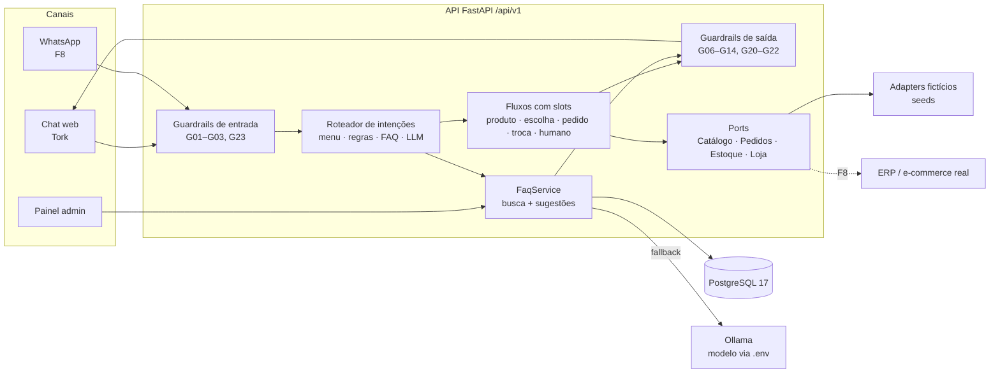
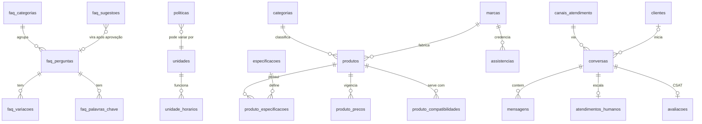
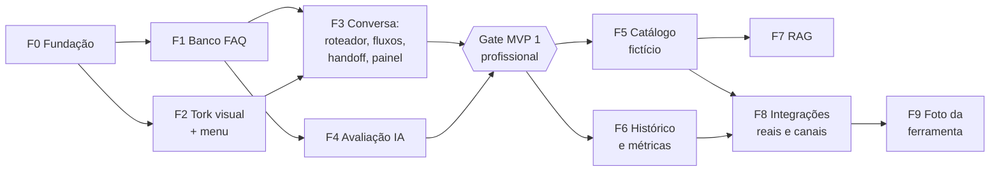

# 0005 — Plano de profissionalização (v2)

> ⚠️ **Atualização de 2026-11-23:** a [análise crítica](0006-Analise-Critica.md) avaliou este plano com nota 9–11/15 (custo, tempo, risco) e recomendou cortar ~40% do escopo e acrescentar uma fase de descoberta. **O plano executável vigente é o [`0007-Tasks-Reinicio-do-Projeto.md`](0007-Tasks-Reinicio-do-Projeto.md).** Este documento continua valendo como visão, arquitetura alvo e catálogo de decisões.
>
> **Versão:** 2.0 · **Data:** 2026-11-23 · **Status:** proposta para aprovação do time
>
> **O que mudou da v1 (2026-11-19):** o Tork deixa de ser só um FAQ e vira um **assistente de loja**,
> com menu, fluxos guiados, escalonamento para humano e métricas. A v2 incorpora:
> o roteiro de chatbot proposto pelo time, uma pesquisa sobre o que clientes de lojas de ferramentas
> perguntam e reclamam, a stack 100% gratuita e o time de 4 pessoas.
>
> **Documentos que este plano integra:**
> | Documento | Papel |
> |-----------|-------|
> | [`0003-Requisitos-do-Produto.md`](0003-Requisitos-do-Produto.md) | Checklist original do produto e 60 FAQs |
> | [`0004-Plano-de-Banco-de-Dados.md`](0004-Plano-de-Banco-de-Dados.md) | Plano do banco PostgreSQL (citado como **DB §n**) |
> | [`0008-Desenho-Conversacional.md`](0008-Desenho-Conversacional.md) | **Novo:** intenções, menu, fluxos, mensagens, escalonamento, métricas |
> | [`0009-Identidade-Visual.md`](0009-Identidade-Visual.md) | Tork: nome, avatar, cores, tom de voz |
> | [`0010-Stack-e-Ferramentas.md`](0010-Stack-e-Ferramentas.md) | **Novo:** ferramentas gratuitas e hospedagem |

---

## 1. Onde estamos (diagnóstico)

O MVP demonstrado funciona: responde pelo banco, usa o Ollama quando a pergunta é nova, aprende, entende continuações ("e para metal?") e tem 19 guardrails.

| Área | Hoje (v0.2) | Lacuna para o nível profissional |
|------|-------------|----------------------------------|
| **Produto** | Responde perguntas soltas (FAQ) | **Assistente de loja:** menu, fluxos (produto, escolha, pedido, troca, atendente), respostas da loja configuráveis |
| Conteúdo | 60 FAQs técnicas e comerciais genéricas | 150 FAQs + 450 variações (DB §6) cobrindo **as dúvidas reais**: voltagem, garantia/CDC, assistência, compatibilidade, manutenção |
| Atendimento humano | Só sugere "fale com um atendente" | Handoff com resumo, consentimento, horário e fila |
| Banco | SQLite, uma tabela desnormalizada | PostgreSQL 17 em 3FN, migrações com rollback |
| Dados da loja | Inexistentes (o Tork não sabe horário nem endereço) | Tabelas `unidades` e `politicas` configuráveis |
| Integrações | Nenhuma | Interfaces (*ports*) com implementação **fictícia** → real depois (catálogo, pedidos, estoque) |
| IA | Modelo padrão divergente; `qwen2.5:3b` em branch **sem licença comercial** | Escolha por avaliação, com modelo Apache 2.0 (Qwen3) |
| Qualidade | 572 testes; sem lint nem CI | CI completo (lint, tipos, testes, e2e, segurança) |
| Frontend | HTML funcional sem marca | Identidade do Tork, menu em botões, cards, CSAT, acessibilidade AA |
| Métricas | Nenhuma | Contenção, fallback, CSAT, escalonamento, top perguntas sem resposta |
| Processo | 4 pessoas sem combinados | GitHub Flow, frentes, milestones, revisão obrigatória |

### Pendências do repositório (resolver primeiro)

1. O commit `004c45e` (contexto + guardrails) e o `fcd1748` (replanejamento) estão **fora da `main`**.
2. A branch `feat/modelo-qwen2.5-3b` (de `susejgo89`) troca o padrão para `qwen2.5:3b`. Ela:
   - saiu da `main` antiga e vai conflitar com o `004c45e`;
   - usa um modelo com *Qwen Research License*, **sem uso comercial**.
   Proposta: substituir pelo `qwen3` (Apache) ou deixar o modelo só no `.env` até a avaliação da F4.
3. O `README.md` local tem um link para um Google Docs pessoal, não commitado: decidir se pode ser público.

---

## 2. Visão e princípios

**Visão:** o Tork é o atendente da ToolExpert. Ele ajuda o cliente a **encontrar e escolher** a ferramenta certa, tira dúvidas técnicas com segurança, orienta sobre **pedidos, pagamento, trocas e garantia** e chama um humano quando é a melhor saída. Nunca inventa preço, estoque, prazo ou compatibilidade.

**Princípios:**
1. **Dado da loja vem do sistema, nunca do LLM.** Preço, estoque, pedido, horário e endereço vêm de configuração ou integração; enquanto não houver, o Tork diz que não consulta.
2. **Banco primeiro, IA depois.** Resposta revisada vence resposta gerada.
3. **Fluxo guiado para tarefa; texto livre para dúvida.** Menu e máquinas de estado para "achar produto", "meu pedido", "trocar"; FAQ e IA para perguntas.
4. **Humano no circuito.** O que a IA cria é sugestão até ser aprovado; o atendente está sempre a um clique.
5. **Segurança e privacidade por padrão.** Guardrails em camadas, LLM local, dados pessoais mascarados, sem CPF em chat aberto.
6. **Grátis e reprodutível.** Só open source ou GitHub público; `make up && make test` em qualquer máquina, sem internet.
7. **Nada é "feito" sem evidência.** Teste passando, log de execução e checklist marcado (DB §0).

---

## 3. Decisões para aprovar

Depois de aprovada, cada decisão vira um ADR em `docs/adr/` e uma linha em [`0016-Registro-de-Decisoes.md`](0016-Registro-de-Decisoes.md).

### Dados e backend

| # | Decisão | Recomendação | Motivo |
|---|---------|--------------|--------|
| D008 | Migrações | **Alembic com SQL explícito** (`op.execute`), `upgrade`/`downgrade` | Padrão do Python; rollback testável; SQL legível |
| D009 | Acesso ao banco | **psycopg 3 + SQL parametrizado** em `repositories/` | DB §7; fácil de auditar |
| D010 | Respostas aprendidas | Tabela **`faq_sugestoes`**; viram FAQ só após aprovação | FAQ oficial limpa; privilégio mínimo (DB §9) |
| D011 | Busca no Postgres | **`unaccent` + `pg_trgm` + `ILIKE`** + pontuação atual | Acentos e erros de digitação (DB §8) |
| D019 | Versão do Postgres | **PostgreSQL 17** (imagem `pgvector/pgvector:pg17`) | O plano pede 16+; a 17 é estável e já traz o pgvector para a F7 |
| D020 | Dados da loja | Tabelas **`unidades`** (endereço, horários, mapa) e **`politicas`** (pagamento, troca, frete, garantia), editáveis no painel | O roteiro precisa de horário, endereço e políticas; o LLM nunca deve "saber" isso |
| D023 | Integrações | **Ports & adapters:** `CatalogoPort`, `PedidosPort`, `EstoquePort` com implementação **fictícia** (seeds) até existir ERP real | Desenvolver e testar os fluxos sem depender da loja real |

### Conversa e IA

| # | Decisão | Recomendação | Motivo |
|---|---------|--------------|--------|
| D012 | Modelo LLM padrão | Avaliar **`qwen3:4b`, `qwen3:8b`** (Apache 2.0) e `llama3.2:3b` na F4; até lá, modelo só pelo `.env`. **Não usar `qwen2.5:3b`** | Licença comercial + decisão com dados; a máquina tem 32 GB e roda 8B |
| D013 | pgvector | Dimensão do embedding **local** (ex.: `nomic-embed-text` = 768), só na F7 | O `sql/0003` usa 1536 (OpenAI) |
| D014 | "Sem LLM" do DB §7 | Vale para a **camada de banco**; o agente usa o Ollama como fallback, atrás de `USAR_OLLAMA` | Preserva o que foi demonstrado |
| D021 | Roteamento | **Roteador de intenções em camadas:** botão do menu → regras/palavras-chave → busca na FAQ → LLM só para classificar ou responder texto livre | Previsível, rápido e testável; o LLM não decide fluxos críticos |
| D022 | Fluxos | **Máquinas de estado com slots**, definidas em código e testadas; no máximo 2 perguntas por mensagem | Roteiro do time com o limite de 1–3 perguntas do checklist |
| D024 | CPF e dados pessoais | **Nunca pedir CPF no chat aberto.** Na F8, a consulta de pedido usa número + um fator de verificação em formulário autenticado; nada disso vai para LLM, log ou histórico | O roteiro pedia CPF; conflita com o G02 e com a LGPD |

### Produto, frontend e processo

| # | Decisão | Recomendação | Motivo |
|---|---------|--------------|--------|
| D015 | Frontend | **HTML/CSS/JS sem build**, modularizado; reavaliar React se o painel admin crescer | Time pequeno, entrega rápida |
| D016 | Branches | **GitHub Flow**: `main` protegida, PR + 1 revisão + CI verde | Leve para 4 pessoas |
| D017 | Idioma | pt-BR em código, commits, PRs e docs | Padrão atual |
| D018 | Atendente | **Tork**, da **ToolExpert AI** | Ver identidade visual |
| D025 | Ferramentas | Stack de [`0010-Stack-e-Ferramentas.md`](0010-Stack-e-Ferramentas.md): **uv**, Ruff, mypy, pre-commit, gitleaks, Playwright, promptfoo, Release Please | Tudo gratuito; o uv resolve as `.venv` duplicadas |
| D026 | Hospedagem | **PC do time + Cloudflare Tunnel** para demos; **Oracle Cloud Always Free** quando precisar ficar 24 h no ar | Únicas opções gratuitas sem prazo que rodam LLM |
| D027 | Menu inicial | Os 5 itens do roteiro **+ "Trocas e garantia"** | É das maiores fontes de reclamação no setor |

---

## 4. Arquitetura alvo



### Estrutura do repositório alvo

```
toolexpert-ai/
├─ app/
│  ├─ api/v1/            chat, faq, sugestoes, atendimentos, loja, health
│  ├─ core/              config (pydantic-settings), logging, erros
│  ├─ conversa/          roteador.py, intencoes.py, fluxos/ (produto, escolha, pedido, troca, humano), estado.py
│  ├─ guardrails/        G01–G24
│  ├─ services/          faq_service.py, atendimento_service.py, loja_service.py
│  ├─ ports/             catalogo.py, pedidos.py, estoque.py (interfaces)
│  ├─ adapters/          ficticio/ (seeds), erp/ (F8)
│  ├─ repositories/      SQL parametrizado
│  ├─ llm/               cliente Ollama, prompts versionados
│  └─ main.py
├─ database/             migrations/ (Alembic), seeds/ (+ data/faq.yaml), tests/
├─ static/               css/, js/, brand/, fonts/
├─ tests/                unit/, integration/, e2e/ (Playwright), eval/ (promptfoo), conversa/ (fluxos)
├─ docs/                 db/, adr/, guias, este plano
├─ docker-compose.yml    api + postgres + ollama (+ caddy em produção)
├─ Dockerfile · Makefile · pyproject.toml (uv) · .pre-commit-config.yaml
└─ .github/              workflows/, PULL_REQUEST_TEMPLATE.md, ISSUE_TEMPLATE/, CODEOWNERS
```

### Modelo de dados por fase



| Fase | Tabelas |
|------|---------|
| **F1** FAQ | `faq_categorias`, `faq_perguntas`, `faq_variacoes`, `faq_palavras_chave`, `faq_sugestoes` |
| **F3** Loja e atendimento | `unidades`, `unidade_horarios`, `politicas`, `atendimentos_humanos`, `avaliacoes` |
| **F5** Catálogo | `categorias`, `marcas`, `produtos`, `especificacoes`, `produto_especificacoes`, `produto_imagens`, `produto_precos`, **`produto_compatibilidades`**, **`assistencias`** |
| **F6** Histórico | `clientes` (sintéticos), `canais_atendimento`, `conversas`, `mensagens` (+ coluna `intencao`) |
| **F8** Comercial | `locais_estoque`, `estoques`, `pedidos`, `pedido_itens`, **`avise_me`** (com consentimento) |

Em negrito, as tabelas acrescentadas ao DB §3–5 por causa da pesquisa e do roteiro (compatibilidade, assistência técnica, avise-me).

---

## 5. Guardrails novos

Somam-se aos G01–G19 já implementados ([`0013-Guardrails.md`](0013-Guardrails.md)):

| ID | Camada | Regra | Origem |
|----|--------|-------|--------|
| G20 | Saída/fluxo | Antes de indicar ferramenta **com fio**, confirmar a voltagem (127 V / 220 V / bivolt); nunca adivinhar a voltagem de uma cidade | Reclamações de voltagem errada |
| G21 | Escalonamento | Oferecer humano: pedido explícito, 2 fallbacks seguidos, frustração, atraso/produto errado, risco elétrico, PJ | Roteiro + pesquisa |
| G22 | Saída | Prazos de garantia ou arrependimento só nos textos aprovados (CDC art. 26 e 49); nunca calcular o prazo de um caso concreto | Risco jurídico |
| G23 | Entrada | Consentimento explícito antes de coletar nome ou contato (handoff, avise-me); finalidade e retenção informadas | LGPD |
| G24 | Saída | Produto, preço e estoque **só** com dado vindo de um *port*; o texto do LLM com produto ou modelo comercial específico é bloqueado | "Nunca inventar" |

---

## 6. Roadmap por fases



**Paralelismo:** depois da F0, F1 (Dados) e F2 (Experiência) andam juntas; a F4 (IA) começa assim que a F1 tiver a base de 150 FAQs.

### F0 — Fundação

**Objetivo:** repositório limpo, reproduzível, com qualidade automática. **Dono sugerido:** Plataforma.

- [ ] PR com `004c45e` + `fcd1748` para a `main`.
- [ ] Resolver a branch do `qwen2.5:3b` (D012): modelo via `.env`, com padrão provisório `llama3.2:3b`.
- [ ] Migrar para **uv** + `pyproject.toml` (Python 3.13 fixado) (D025).
- [ ] Ruff, mypy, pytest-cov, **pre-commit** com gitleaks; `.gitattributes` (fim de linha).
- [ ] GitHub Actions: lint, tipos, testes, cobertura ≥ 85%, CodeQL, Dependabot, Release Please.
- [ ] Proteção da `main`, CODEOWNERS por frente, templates de PR e issue, `CONTRIBUTING.md`, `LICENSE`, `SECURITY.md`.
- [ ] `app/core/config.py` (pydantic-settings) e `.env.example` completo.
- [ ] `docker-compose.yml` (Postgres 17 + pgvector, Ollama, API) e `Makefile`.
- [ ] GitHub Projects: kanban, milestones F0–F4, labels; issues criadas a partir deste plano.
- [ ] `docs/db/EXECUTION_LOG.md` e `docs/adr/` (ADRs das decisões aprovadas).

**Aceite:** máquina limpa roda `make up && make test`; CI verde na `main`; gitleaks sem achados.

### F1 — Banco PostgreSQL e conteúdo (DB §0, 1, 2, 6-FAQ, 7, 8, 9, 10)

**Objetivo:** trocar o SQLite pelo Postgres normalizado e chegar a 150 FAQs úteis de verdade. **Dono sugerido:** Dados.

**Migrações e acesso**
- [ ] `0001_faq`: `faq_categorias`, `faq_perguntas`, `faq_variacoes`, `faq_palavras_chave` (DB §2 + palavras-chave).
- [ ] `0002_sugestoes`: `faq_sugestoes` (D010). `0003_busca`: `unaccent`, `pg_trgm` e índices (D011).
- [ ] `atualizado_em` por trigger; rollback `upgrade → downgrade → upgrade` testado.
- [ ] `FaqRepository` (DB §7) e portar `app/busca.py` sem mudar o comportamento.
- [ ] Papéis `toolexpert_migrator` e `toolexpert_app` (DB §9); `/health` com o banco.
- [ ] `sql/0001–0003` vão para `docs/db/legado/`.

**Conteúdo (150 FAQs + 450 variações em `database/seeds/data/faq.yaml`)**
- [ ] Remapear as 60 atuais para as 8 categorias do DB §6.
- [ ] Escrever 90 novas, priorizando o que a pesquisa mostrou:
  - **voltagem** (127 × 220 × bivolt, como descobrir, o que acontece se ligar errado, transformador);
  - **garantia e CDC** (90 dias, arrependimento de 7 dias, garantia do fabricante, assistência autorizada, nota fiscal);
  - **compatibilidade** (baterias por plataforma, encaixes SDS e mandril, discos por diâmetro e rotação, bits);
  - **manutenção e diagnóstico** (perda de força, faísca, escova de carvão, bateria que não carrega);
  - **como fazer** (furar azulejo, porcelanato, concreto, metal; cortar em curva; lixar);
  - **compra** (com fio × bateria, doméstico × profissional, kits, acessórios essenciais).
- [ ] 3 variações por pergunta, com linguagem real (inclusive erros comuns: "furadera", "esmerilhadera", "makita" como nome genérico).
- [ ] Seed idempotente (`SEED=2026`) e verificador de contagens (150/450/8).

**Testes e documentação**
- [ ] DB §8 completo: migrações, rollback, FKs, unicidades, contagens, SQL injection, acentos.
- [ ] Os 572 testes atuais passando contra o Postgres.
- [ ] Revisão humana de uma amostra de 30 FAQs, registrada.
- [ ] `docs/db/` completo: README, DER, dicionário, catálogo de seeds, segurança e log.

**Aceite:** definição de pronto do DB §10 + suíte atual verde no Postgres.

### F2 — Tork visual, menu e frontend

**Objetivo:** o chat com a cara do Tork e a navegação do roteiro. **Dono sugerido:** Experiência.

- [ ] Aprovar a [identidade visual](0009-Identidade-Visual.md); fontes locais; tokens de cor.
- [ ] Separar `static/` em `css/` e `js/` (ES modules).
- [ ] Cabeçalho com logo e "Tork online"; balões com avatar; selos Banco / Tork IA / Guardrail.
- [ ] **Boas-vindas e menu inicial em botões** (6 itens, D027), com "digite *menu* a qualquer momento".
- [ ] Respostas rápidas como chips; **cards** de produto (estrutura pronta, alimentados na F5).
- [ ] Estados: pensando, erro (Tork em alerta), aviso de segurança, fora do horário.
- [ ] **Encerramento com CSAT** (👍/👎) enviado para a API.
- [ ] Tema claro e escuro, 320–1440 px, `prefers-reduced-motion`, acessibilidade AA.
- [ ] Playwright: menu, fluxo, contexto, nova conversa, erro, CSAT. Lighthouse ≥ 90.

**Aceite:** e2e verdes no CI; Lighthouse ≥ 90; revisão visual do time em celular e desktop.

### F3 — Conversa: roteador, fluxos, atendimento humano e painel

**Objetivo:** implementar o [desenho conversacional](0008-Desenho-Conversacional.md). **Donos sugeridos:** IA (roteador e fluxos) + Plataforma (API e painel).

**Conversa**
- [ ] `app/conversa/roteador.py` (D021) e catálogo de intenções I01–I25.
- [ ] Estado da conversa por `conversationId` (fluxo atual, slots, contagem de fallbacks).
- [ ] Fluxos **F-PROD**, **F-ESCOLHA**, **F-PEDIDO** (versão sem integração), **F-TROCA** (CDC + política) e **F-HUMANO** (D022).
- [ ] Guardrails G20–G24, com testes nos dois sentidos.
- [ ] Mensagens-padrão na voz do Tork em `app/guardrails/prompts.py`.

**Loja e atendimento**
- [ ] Migrações `unidades`, `unidade_horarios`, `politicas`, `atendimentos_humanos` e `avaliacoes` (D020), com seed fictício.
- [ ] Respostas rápidas (horário, endereço, pagamento, trocas, retirada) **a partir da configuração**.
- [ ] Handoff: registro com resumo, motivo e prioridade; comportamento dentro e fora do horário.

**API e painel**
- [ ] `/api/v1`, modelo de erro padrão, logs JSON, rate limit, CORS por configuração, `Dockerfile`.
- [ ] **Painel admin** (`/admin`, senha de ambiente): aprovar sugestões, ver a fila de atendimentos, editar unidades e políticas.

**Aceite:** os 6 caminhos do menu funcionam de ponta a ponta; "pergunta nova → sugestão → aprovação → vem do banco" testado; nenhum dado da loja sai do LLM.

### F4 — Avaliação e qualidade da IA

**Objetivo:** escolher o modelo e medir o Tork com números. **Dono sugerido:** IA.

- [ ] Conjunto-ouro em `tests/eval/` (promptfoo):
  - 150 FAQs + variações (busca);
  - 100 frases de intenção (roteador I01–I25);
  - 40 continuações (contexto);
  - 30 conversas de fluxo completo;
  - 60 casos de red team (injeção, preço inventado, conselho perigoso, CPF, voltagem).
- [ ] Metas: busca ≥ 95%; intenção ≥ 90%; guardrails com 100% de bloqueio nos casos críticos e ≤ 2% de falso positivo; latência p95 ≤ 3 s (banco) e ≤ 8 s (IA).
- [ ] Comparar `qwen3:4b`, `qwen3:8b` e `llama3.2:3b`; registrar a D012.
- [ ] Prompts versionados (`app/llm/prompts/`); `make eval` gera o relatório em `docs/eval/`.

**Aceite:** relatório publicado e modelo padrão escolhido com base nele.

### Gate — Aprovação do "MVP 1 profissional"

Demonstrar ao time e ao responsável da loja: os 6 caminhos do menu, a base de 150 FAQs, os relatórios de testes e de avaliação e as métricas. **F5 em diante só começa após aprovação explícita** (DB §11).

### F5 — Catálogo fictício e busca de produtos (DB §3)

- [ ] Migrações do catálogo + `produto_compatibilidades` + `assistencias` (vigências de preço sem sobreposição com `EXCLUDE USING gist`).
- [ ] Seed fictício: 25 categorias, 15 marcas fictícias, 300 produtos `FAKE-0001…`, 40 especificações, 1.500 associações, preços, compatibilidades e assistências por cidade.
- [ ] `CatalogoPort` com o adapter fictício; F-PROD mostra **cards**; compatibilidade só com dado da tabela.
- [ ] Localizar assistência técnica por marca e cidade.

### F6 — Histórico e métricas (DB §4)

- [ ] `clientes` (sintéticos), `canais_atendimento`, `conversas` e `mensagens` (com `intencao`); a memória em RAM passa para o banco.
- [ ] Retenção (ex.: 90 dias) e anonimização em `docs/db/SECURITY.md`.
- [ ] Painel de métricas: contenção, fallback, escalonamento, CSAT, top perguntas sem resposta (revisão semanal vira FAQs novas).

### F7 — RAG com manuais

- [ ] Embeddings locais (D013), `faq_embeddings` e busca híbrida (trigram + vetor).
- [ ] Manuais e fichas técnicas validadas como fonte; adotar só se a F4 mostrar ganho.

### F8 — Integrações reais e canais (DB §5)

- [ ] Adapters reais de catálogo, estoque, preço e pedidos (ERP ou e-commerce da loja).
- [ ] F-PEDIDO com consulta real (D024): número + verificação em formulário autenticado.
- [ ] Frete e prazo calculados; outra unidade; **avise-me** com consentimento (G23).
- [ ] WhatsApp Business Platform; transferência real para vendedor.
- [ ] `locais_estoque`, `estoques`, `pedidos` e `pedido_itens`; nenhuma operação financeira no chat.

### F9 — "Envie uma foto da ferramenta"

- [ ] Avaliar modelo multimodal local com licença comercial (ver `0010-Stack-e-Ferramentas.md`); identificar o **tipo** de ferramenta, nunca afirmar modelo ou estado de segurança pela foto.

---

## 7. Como trabalhamos

**Fluxo de uma tarefa:** issue com critério de aceite → branch `feature/<nº>-<descricao>` → commits semânticos em pt-BR → PR com template → CI verde + 1 revisão → *squash merge* → `Closes #n` → entrada em `docs/0017-Registro-de-Prompts.md` quando a tarefa veio de prompt de IA.

| Item | Combinado |
|------|-----------|
| Commits | Conventional Commits em pt-BR (`feat:`, `fix:`, `docs:`, `test:`, `refactor:`, `chore:`, `ci:`) |
| PR | Pequena (< 400 linhas), com o quê / por quê / como testar / evidências |
| Revisão | 1 aprovação de outra pessoa; CODEOWNERS indica quem revisa cada área |
| Antes de enviar commits | Conferir se a PR da branch ainda está aberta (`gh pr view`); se já foi mergeada, abrir branch e PR novas |
| Definition of Ready | Objetivo, critério de aceite e dependências claros |
| Definition of Done | Código + testes + docs + CI verde + checklist marcado com evidência |
| Versões | SemVer automático (Release Please): `v0.3.0` ao fim da F1, `v1.0.0` no Gate |
| Labels | `fase:F0…F9`, `tipo:*`, `area:dados/experiencia/ia/plataforma`, `prioridade:*` |
| Ritmo semanal | Segunda: planejamento de 30 min · dias úteis: atualização assíncrona no canal · sexta: demonstração e revisão de métricas |

**Frentes para 4 pessoas** (o time decide quem fica com cada uma):

| Frente | Responsabilidades | Fases principais |
|--------|-------------------|------------------|
| **Dados** | Postgres, migrações, seeds, conteúdo das FAQs, catálogo | F1, F5, F6 |
| **Experiência** | Identidade do Tork, frontend, menu, cards, acessibilidade, e2e | F2, telas da F3 |
| **IA e conversa** | Roteador, fluxos, guardrails, prompts, avaliação, modelo | F3, F4, F7, F9 |
| **Plataforma** | uv, CI/CD, Docker, API, painel, hospedagem, segurança | F0, API da F3, F8 |

---

## 8. Qualidade, segurança e LGPD

| Tema | Regra |
|------|-------|
| Testes | Unitários → integração (Postgres real) → fluxos de conversa → e2e (Playwright) → avaliação de IA (promptfoo) |
| Cobertura | ≥ 85% geral; ≥ 95% em `guardrails/` e `conversa/` |
| Segredos | `.env` + GitHub Secrets; gitleaks no pre-commit e no CI |
| Banco | Papéis separados; app com privilégio mínimo; Postgres nunca exposto |
| Dados pessoais | Mascarados (G02); sem CPF no chat (D024); consentimento (G23); retenção (F6); seeds sintéticos |
| Conteúdo jurídico | Textos do CDC revisados por responsável antes de publicar (G22) |
| Dependências | Fixadas pelo uv; Dependabot; pip-audit e Trivy no CI |
| Backup | `pg_dump` diário + restauração testada antes de ambiente persistente |

---

## 9. Riscos

| Risco | Impacto | Mitigação |
|-------|---------|-----------|
| Modelo pequeno inventa conteúdo técnico | Alto | Guardrails, sugestões com aprovação, avaliação na F4 |
| Licença de modelo inadequada para uso comercial | Alto | Só Apache/MIT ou licença comercial verificada (D012) |
| Texto jurídico errado (garantia, arrependimento) | Alto | Textos fixos aprovados (G22); sem cálculo de prazo |
| Cliente espera preço e estoque antes da F8 | Médio | Mensagem clara + atendente; cards só com dado fictício rotulado em demo |
| 90 FAQs novas com erro técnico | Alto | Revisão em PR + amostra de 30 revisada por humano |
| Migração para Postgres quebrar o comportamento | Médio | Suíte atual inteira contra o Postgres antes de remover o SQLite |
| 4 pessoas no mesmo arquivo | Médio | Frentes, PRs pequenas, CODEOWNERS |
| Escopo crescer antes do Gate | Médio | F5–F9 bloqueadas até aprovação |
| Nome "Tork" registrado | Baixo | Verificar no INPI |

---

## 10. Próximos passos imediatos

1. **Time:** aprovar D008–D027, a identidade visual e o desenho conversacional (ou ajustar).
2. Definir quem fica com cada frente (Dados, Experiência, IA e conversa, Plataforma).
3. Abrir a PR com contexto + guardrails + replanejamento; resolver a branch do `qwen2.5:3b`.
4. Criar o GitHub Projects, os milestones F0–F4 e as issues a partir das checklists.
5. Executar a F0; em seguida, F1 e F2 em paralelo.
