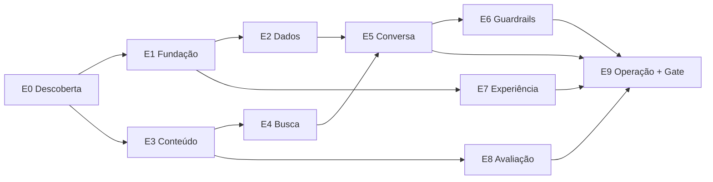

# 0007 — Tasks: reinício do projeto ToolExpert AI

> 🔴 **Até a entrega de 29/11/2026, o plano vigente é o [`0018-Plano-de-Entrega-29-11.md`](0018-Plano-de-Entrega-29-11.md)**, que seleciona ~15–20% destas tasks. Este arquivo vale para depois da entrega.
>
> **Versão:** 1.0 · **Data:** 2026-11-23 · **Status:** proposta para aprovação do time
> **O que é:** a lista de tarefas **como se o projeto recomeçasse do zero**, já incorporando:
> - o que aprendemos no MVP;
> - o [plano v2](0005-Plano-de-Profissionalizacao.md);
> - a [análise crítica](0006-Analise-Critica.md) e a recomendação dela (escopo cortado em ~40% + fase de descoberta).
>
> O código da v0.2 é **reaproveitado** onde indicado (♻️); "reiniciar" quer dizer replanejar, não reescrever.

## Como ler

- **Cada épico** tem as **11 perguntas críticas** respondidas.
- **Cada task** tem entrega, aceite, dependências, esforço e frente, e uma **crítica compacta**:
  - ⚠️ ponto fraco;
  - 🧪 suposição perigosa;
  - 💡 alternativa mais simples;
  - **Nota C/T/R**: custo, tempo e risco de erro, de **1 (ótimo) a 5 (péssimo)**, avaliada com rigor.
- **Esforço** em dias-pessoa (d), estimativa inicial a recalibrar após a 1ª semana.
- **Frentes:** Produto · Plataforma · Dados · IA e conversa · Experiência.

## Visão geral

| Épico | Objetivo | Tasks | Esforço | Pode começar após |
|-------|----------|:-----:|:-------:|-------------------|
| **E0** Descoberta | Objetivo, dono, revisores, perguntas reais | 6 | 4,5 d | — |
| **E1** Fundação | Repositório reproduzível com CI | 8 | 5,5 d | E0 (T-001) |
| **E2** Dados | PostgreSQL normalizado para a FAQ | 7 | 7 d | E1 |
| **E3** Conteúdo | 150 FAQs + 450 variações revisadas | 5 | 10 d | E0 |
| **E4** Busca | Melhor método de busca, medido | 2 | 4 d | E3 (parcial) |
| **E5** Conversa | Menu, fluxos, atendimento humano | 8 | 11,5 d | E2, E4 |
| **E6** Guardrails | G20–G24 + red team | 4 | 3,5 d | E5 |
| **E7** Experiência | Tork visual, menu, acessibilidade, e2e | 6 | 9 d | E1 |
| **E8** Avaliação de IA | Conjunto-ouro e escolha do modelo | 3 | 5,5 d | E3 |
| **E9** Operação e Gate | API, painel, publicação, teste com usuários | 6 | 10 d | E5, E7 |
| **Total até o Gate** | | **55** | **~70 d** | |

**Prazo realista:** 4 pessoas × ~10 h/semana ≈ 5 d/semana → **~14 semanas**, ou **~18 com 30% de folga**.
Se o prazo do projeto for menor, os cortes sugeridos estão no fim do arquivo.

---

## E0 — Descoberta e definição · Frente: Produto

> Não existia no plano original. A análise crítica mostrou que o maior risco é **não saber para quem e até quando** estamos construindo.

### Análise crítica do épico

| # | Pergunta | Resposta |
|---|----------|----------|
| 1 | Pontos fracos | Pode virar uma "fase de reuniões" sem fim; entrevistas difíceis de conseguir; o time pode achar perda de tempo; sem uma loja parceira, a descoberta fica superficial; as decisões podem ser adiadas de novo |
| 2 | Por que fracassaria | Ninguém marca as entrevistas; o objetivo continua vago ("um bot bom"); ninguém aceita o papel de revisor |
| 3 | Suposições perigosas | Que 3–5 vendedores aceitarão conversar; que o time concorda sobre o objetivo; que existe alguém com conhecimento técnico para revisar |
| 4 | Três alternativas | (a) Pular entrevistas e usar só a pesquisa já feita (Reclame Aqui, FAQs); (b) um formulário online para clientes de loja; (c) passar 2 h observando o balcão de uma loja física |
| 5 | Mais simples × mais robusta | Simples: reunião de 1 h para decidir objetivo, prazo e donos. Robusta: entrevistas + observação + formulário + priorização por volume |
| 6 | Outra área | Gestão de produto: *Lean Startup*, validar o problema antes da solução. Antropologia: observação em campo revela perguntas que ninguém lembra de citar |
| 7 | Dados contrários | A pesquisa de mercado já feita cobre parte do que as entrevistas trariam; para um projeto acadêmico, o "cliente" pode ser a banca |
| 8 | Nota C/T/R | **1/2/1**: barato, rápido, reduz muito o risco do resto |
| 9 | O que falta perguntar | Existe banca ou data de entrega? Há uma loja real disposta a testar? Quanto tempo cada pessoa tem de fato por semana? |
| 10 | Denominador comum | 1 reunião de decisão (T-001, T-002, T-005) **e** pelo menos 3 conversas reais (T-003) em até 1 semana; sem isso, seguir com a pesquisa existente e registrar a limitação |
| 11 | Sem concordar por educação | Pular este épico é o erro mais provável e mais caro do projeto |

### Tasks

#### T-001 · Definir objetivo, prazo e público do projeto
- **Entrega:** `docs/0001-Contexto.md` atualizado com objetivo (acadêmico, portfólio ou loja real), prazo final e quem avalia o sucesso. **Aceite:** decisão registrada e aprovada pelo time. **Depende:** — · **Esforço:** 0,5 d · **Frente:** Produto
- ⚠️ Pode ficar genérico ("aprender IA") · 🧪 Que todos têm o mesmo objetivo · 💡 Uma frase: "Entregar X para Y até Z" · **C/T/R 1/1/1**

#### T-002 · Nomear o dono do produto e os donos das frentes
- **Entrega:** tabela pessoa → frente → horas por semana, no `0001-Contexto.md`. **Aceite:** 4 pessoas confirmadas, ou escopo ajustado a quem confirmou. **Depende:** T-001 · **Esforço:** 0,5 d · **Frente:** Produto
- ⚠️ Compromissos de horas otimistas · 🧪 Que os 3 colaboradores estão ativos · 💡 Começar com quem já está ativo e somar os outros depois · **C/T/R 1/1/2**

#### T-003 · Levantar as 30 perguntas reais mais frequentes
- **Entrega:** `docs/descoberta/perguntas-reais.md` com 30 perguntas, frequência estimada e fonte (entrevista, observação ou pesquisa). **Aceite:** pelo menos 3 fontes humanas, ou limitação registrada. **Depende:** T-001 · **Esforço:** 2 d · **Frente:** Produto
- ⚠️ Amostra pequena e enviesada · 🧪 Que vendedores lembram o que perguntam · 💡 Usar a pesquisa já feita + 1 conversa · **C/T/R 1/3/2**

#### T-004 · Definir os revisores técnico e jurídico
- **Entrega:** nomes (ou "vaga aberta") para revisão técnica (ferramentas e segurança) e jurídico-comercial (CDC). **Aceite:** revisor confirmado ou plano B registrado (ex.: professor, profissional da área). **Depende:** T-001 · **Esforço:** 0,5 d · **Frente:** Produto
- ⚠️ Ninguém aceita · 🧪 Que o time pode revisar segurança sozinho · 💡 Revisão cruzada no time + fontes oficiais citadas em cada FAQ · **C/T/R 1/2/3**

#### T-005 · Congelar o escopo do MVP 1 e os critérios de sucesso
- **Entrega:** seção "Escopo congelado" no `0001-Contexto.md`, com o que está dentro, o que está fora e as metas (busca ≥ 95%, contenção ≥ 60%, CSAT ≥ 80%, 5 testes com usuários). **Aceite:** aprovado pelo dono do produto. **Depende:** T-001 a T-004 · **Esforço:** 0,5 d · **Frente:** Produto
- ⚠️ Escopo "congelado" que continua crescendo · 🧪 Que as metas são mensuráveis sem usuários reais · 💡 Lista "dentro/fora" de uma página · **C/T/R 1/1/2**

#### T-006 · Aprovar a identidade do Tork e o desenho conversacional
- **Entrega:** aprovação (ou ajustes) de `0009-Identidade-Visual.md` e `0008-Desenho-Conversacional.md`. **Aceite:** registro no `0016-Registro-de-Decisoes.md`. **Depende:** T-005 · **Esforço:** 0,5 d · **Frente:** Produto
- ⚠️ Discussão estética sem fim · 🧪 Que o nome "Tork" está livre (INPI) · 💡 Aprovar como está e iterar depois · **C/T/R 1/1/1**

---

## E1 — Fundação · Frente: Plataforma

### Análise crítica do épico

| # | Pergunta | Resposta |
|---|----------|----------|
| 1 | Pontos fracos | Muita ferramenta nova de uma vez (uv, Ruff, mypy, pre-commit, CI, Docker); curva de aprendizado para o time; nenhum valor visível ao usuário; mypy num código sem tipos gera ruído; Docker no Windows dá trabalho |
| 2 | Por que fracassaria | O CI fica vermelho e o time desativa as checagens; pre-commit irrita e todos usam `--no-verify`; a F0 leva 3 semanas |
| 3 | Suposições perigosas | Que todos têm Docker funcionando; que o uv resolve tudo no Windows; que cobertura de 85% é viável sem atrasar |
| 4 | Três alternativas | (a) Só pytest no CI e mais nada; (b) Dev Containers do VS Code (ambiente idêntico para todos); (c) GitHub Codespaces (grátis com limite de horas; sem instalar nada localmente) |
| 5 | Mais simples × mais robusta | Simples: `requirements.txt` + Ruff + pytest no Actions (1 dia). Robusta: tudo da lista + Dev Container + Release Please |
| 6 | Outra área | Engenharia de manufatura (*5S*, padronização): o posto de trabalho igual para todos reduz defeito; aqui, isso é o Dev Container |
| 7 | Dados contrários | O projeto já tem 572 testes e funciona sem nada disso; o problema atual é de processo (PR fora da main), não de lint |
| 8 | Nota C/T/R | **1/3/2** |
| 9 | O que falta perguntar | Todas as máquinas do time rodam Docker e Ollama? Alguém usa Mac ou Linux? Quanto o CI demora? |
| 10 | Denominador comum | Fazer o essencial (uv, Ruff, pytest no CI, proteção da main, Compose) em até 3 dias; mypy em modo gradual; o resto vem depois |
| 11 | Sem concordar por educação | Release Please, SonarQube e CodeQL **não** são prioridade agora; a proteção da `main` é, porque o problema real foi commit fora da main |

### Tasks

#### T-007 · Consolidar o repositório ♻️
- **Entrega:** PR com contexto + guardrails + documentação mergeada; branch `feat/modelo-qwen2.5-3b` resolvida (modelo via `.env`, padrão provisório `llama3.2:3b`). **Aceite:** `main` contém tudo; nenhuma branch órfã. **Depende:** — · **Esforço:** 0,5 d
- ⚠️ Conflito com a branch do colaborador · 🧪 Que o colaborador aceita trocar o qwen2.5 · 💡 Merge simples e conversa direta com o autor · **C/T/R 1/1/2**

#### T-008 · uv + `pyproject.toml` + Python 3.13
- **Entrega:** `pyproject.toml`, `uv.lock`, `.python-version`; `requirements.txt` removido. **Aceite:** `uv sync && uv run pytest` passa em máquina limpa. **Depende:** T-007 · **Esforço:** 0,5 d
- ⚠️ Mais uma ferramenta para aprender · 🧪 Que todas as dependências têm wheel para 3.13 no Windows · 💡 Manter pip + venv, documentando o caminho completo do Python · **C/T/R 1/1/2**

#### T-009 · Ruff + mypy gradual + pre-commit + gitleaks + `.gitattributes`
- **Entrega:** `.pre-commit-config.yaml`, configuração no `pyproject.toml`, fim de linha normalizado. **Aceite:** `pre-commit run --all-files` limpo. **Depende:** T-008 · **Esforço:** 1 d
- ⚠️ mypy estrito gera centenas de erros · 🧪 Que o time não vai pular hooks · 💡 Só Ruff + gitleaks agora; mypy depois · **C/T/R 1/2/1**

#### T-010 · CI no GitHub Actions
- **Entrega:** `ci.yml` com lint, testes, cobertura e Dependabot. **Aceite:** CI verde na `main`; PR vermelha bloqueada. **Depende:** T-009 · **Esforço:** 1 d
- ⚠️ CI lento ou instável (Ollama não roda no CI) · 🧪 Que os testes não dependem do Ollama (hoje é verdade) · 💡 Só `pytest` no CI · **C/T/R 1/2/2**

#### T-011 · Regras do repositório
- **Entrega:** proteção da `main`, CODEOWNERS, templates de PR e issue, `CONTRIBUTING.md`, `LICENSE`, `SECURITY.md`. **Aceite:** push direto na `main` recusado. **Depende:** T-002 · **Esforço:** 0,5 d
- ⚠️ Revisão obrigatória trava se só 1 pessoa estiver ativa · 🧪 Que haverá revisores disponíveis · 💡 Exigir só o CI verde até haver 2 pessoas ativas · **C/T/R 1/1/2**

#### T-012 · Configuração centralizada
- **Entrega:** `app/core/config.py` (pydantic-settings) e `.env.example` completo. **Aceite:** nenhum `os.getenv` fora do config. **Depende:** T-008 · **Esforço:** 0,5 d
- ⚠️ Refatoração toca muitos arquivos · 🧪 — · 💡 Manter `os.getenv` com nomes documentados · **C/T/R 1/1/1**

#### T-013 · Docker Compose + Makefile
- **Entrega:** `docker-compose.yml` (Postgres 17 + pgvector, Ollama, API) e `Makefile` (`up`, `down`, `test`, `seed`, `lint`). **Aceite:** `make up && make test` funciona em 2 máquinas diferentes. **Depende:** T-008 · **Esforço:** 1 d
- ⚠️ Ollama em container no Windows sem GPU fica lento · 🧪 Que todos têm Docker · 💡 Compose só com o Postgres; Ollama nativo · **C/T/R 1/2/3**

#### T-014 · GitHub Projects e issues
- **Entrega:** kanban, milestones E0–E9, labels e 1 issue por task deste arquivo. **Aceite:** todas as tasks com issue e responsável. **Depende:** T-002 · **Esforço:** 0,5 d
- ⚠️ Quadro que ninguém atualiza · 🧪 Que o time vai usar o GitHub como ferramenta de gestão · 💡 O próprio checklist em Markdown · **C/T/R 1/1/1**

---

## E2 — Dados: PostgreSQL para a FAQ · Frente: Dados

### Análise crítica do épico

| # | Pergunta | Resposta |
|---|----------|----------|
| 1 | Pontos fracos | Para 150 FAQs o SQLite basta; migrar custa ~7 d sem ganho visível ao usuário; Alembic + papéis + triggers é muito para iniciantes; a tabela de palavras-chave pode ficar obsoleta se os embeddings ganharem (E4) |
| 2 | Por que fracassaria | A migração quebra o comportamento e o time fica preso consertando testes; o Postgres no Windows ou Docker trava o desenvolvimento de quem não tem Docker |
| 3 | Suposições perigosas | Que o plano de banco é obrigatório (confirmar em T-001); que 3FN pura é melhor para este volume; que todos conseguem rodar o Postgres |
| 4 | Três alternativas | (a) Ficar no SQLite com o mesmo esquema 3FN (portável depois); (b) Postgres gerenciado gratuito (Supabase ou Neon), sem Docker, mas plano gratuito que pode mudar; (c) FAQ em YAML versionado + índice em memória, sem banco para a FAQ |
| 5 | Mais simples × mais robusta | Simples: esquema 3FN no SQLite com migrações SQL numeradas. Robusta: Postgres 17 + Alembic + papéis + trigram + testes de rollback |
| 6 | Outra área | Arquivologia: a fonte de verdade da FAQ deve ser um documento revisável (YAML em PR); o banco é só o índice operacional, o que favorece a alternativa (c) para o conteúdo |
| 7 | Dados contrários | O SQLite atende milhares de leituras por segundo; o gargalo real é o conteúdo, não o banco |
| 8 | Nota C/T/R | **2/3/3** |
| 9 | O que falta perguntar | O plano de banco é exigência de alguma disciplina? Quem vai operar o Postgres depois? Há backup? |
| 10 | Denominador comum | **Se o plano de banco for entrega obrigatória:** Postgres com o esquema mínimo, sem triggers no início, e com o YAML como fonte de verdade do conteúdo. **Se não for:** o mesmo esquema 3FN no SQLite |
| 11 | Sem concordar por educação | Migrar para o Postgres só porque é "mais profissional" não se justifica neste volume; justifique pelo requisito ou pelas fases futuras |

### Tasks

#### T-015 · DER e dicionário de dados da FAQ
- **Entrega:** `docs/db/DER.md` (Mermaid) e `docs/db/DATA_DICTIONARY.md`. **Aceite:** revisado por outra frente. **Depende:** T-005 · **Esforço:** 1 d
- ⚠️ Documentação que envelhece · 🧪 Que o modelo não muda após o teste da E4 · 💡 DER gerado a partir das migrações · **C/T/R 1/1/1**

#### T-016 · Migração 0001: FAQ (DB §2)
- **Entrega:** `faq_categorias`, `faq_perguntas` e `faq_variacoes`, com unicidades, índices e regras de exclusão. **Aceite:** `upgrade → downgrade → upgrade` sem erro. **Depende:** T-013, T-015 · **Esforço:** 1 d
- ⚠️ Rollback raramente usado e mal testado · 🧪 Que o Alembic é simples para o time · 💡 Arquivos SQL numerados up/down · **C/T/R 1/2/2**

#### T-017 · Migração 0002: `faq_sugestoes`
- **Entrega:** tabela de sugestões (pergunta, resposta, origem, status, revisão). **Aceite:** app só insere; aprovação move para a FAQ. **Depende:** T-016 · **Esforço:** 0,5 d
- ⚠️ Fila cresce sem revisor · 🧪 Que alguém revisa toda semana (T-004) · 💡 Coluna `status` em `faq_perguntas` · **C/T/R 1/1/2**

#### T-018 · Migração 0003: busca
- **Entrega:** a estrutura vencedora do teste da E4 (trigram e/ou `faq_embeddings` com a dimensão correta). **Aceite:** índice usado nas consultas (EXPLAIN). **Depende:** T-028 · **Esforço:** 0,5 d
- ⚠️ Decidir antes do teste · 🧪 Que pgvector "não pode" no MVP (regra do DB §7, questionada) · 💡 Trigram apenas · **C/T/R 1/1/2**

#### T-019 · Papéis de banco e health check
- **Entrega:** `toolexpert_migrator` e `toolexpert_app` com privilégio mínimo; `/health` verifica o banco. **Aceite:** app não consegue `DROP`; health falha com o banco fora. **Depende:** T-016 · **Esforço:** 0,5 d
- ⚠️ Complexidade para desenvolvimento local · 🧪 — · 💡 Um usuário só em desenvolvimento, papéis só em produção · **C/T/R 1/1/1**

#### T-020 · Repositório e migração da aplicação ♻️
- **Entrega:** `FaqRepository` (SQL parametrizado) e app usando Postgres. **Aceite:** os 572 testes passam contra o Postgres. **Depende:** T-016, T-017 · **Esforço:** 2 d
- ⚠️ Testes acoplados ao SQLite · 🧪 Que o comportamento se mantém igual · 💡 Camada de repositório com as duas implementações · **C/T/R 2/3/3**

#### T-021 · Testes do banco (DB §8)
- **Entrega:** FKs, unicidades, rollback, SQL injection, acentos, EXPLAIN registrado. **Aceite:** suíte no CI com Postgres de serviço. **Depende:** T-020 · **Esforço:** 1,5 d
- ⚠️ Testes de banco lentos no CI · 🧪 Que testcontainers funciona no CI do Windows (usar Linux) · 💡 Serviço Postgres do Actions · **C/T/R 1/2/2**

---

## E3 — Conteúdo · Frente: Dados (+ revisores)

### Análise crítica do épico

| # | Pergunta | Resposta |
|---|----------|----------|
| 1 | Pontos fracos | É o épico **mais importante e mais subestimado**; escrever 90 FAQs boas leva tempo; risco técnico e jurídico; tentação de gerar tudo com IA; variações artificiais não refletem como o cliente escreve |
| 2 | Por que fracassaria | FAQs geradas em lote sem revisão, com erro de segurança; ou o épico atrasa e trava a avaliação (E8) |
| 3 | Suposições perigosas | Que 150 é o número certo (o plano de banco fixou, mas o valor está nas perguntas certas); que o time sabe o suficiente de ferramentas; que dá para citar manuais livremente |
| 4 | Três alternativas | (a) Começar com as 30 perguntas reais de T-003 bem escritas e crescer pela fila de sugestões; (b) parceria com um vendedor que dita as respostas; (c) usar as fichas técnicas públicas de fabricantes como fonte, com texto próprio |
| 5 | Mais simples × mais robusta | Simples: 60 atuais + 30 reais revisadas (90). Robusta: 150 + 450 variações + matriz de risco + dupla revisão |
| 6 | Outra área | Jornalismo: toda afirmação com fonte e checagem por uma segunda pessoa. Segurança do trabalho: conteúdo de risco alto (eletricidade, discos) só com fonte normativa |
| 7 | Dados contrários | A pesquisa mostra que as dúvidas que mais geram problema (entrega, garantia) são de **processo**, não técnicas; FAQs técnicas podem ter menos demanda do que o esperado |
| 8 | Nota C/T/R | **1/4/4** |
| 9 | O que falta perguntar | Qual é a licença do conteúdo que vamos usar? Quem mantém a base depois? Como medimos se uma FAQ é útil? |
| 10 | Denominador comum | Meta de 150 mantida (o plano de banco pede), mas **priorizada:** primeiro as 30 reais e os temas da pesquisa; cada FAQ com fonte, nível de risco e revisor; IA só rascunha |
| 11 | Sem concordar por educação | Se faltar tempo, corte quantidade, nunca revisão |

### Tasks

#### T-022 · Taxonomia e remapeamento ♻️
- **Entrega:** 8 categorias do DB §6 + as 60 FAQs remapeadas + campo `nivel_risco` (baixo, médio, alto). **Aceite:** nenhuma FAQ sem categoria e sem risco. **Depende:** T-005 · **Esforço:** 0,5 d
- ⚠️ Categorias do DB §6 misturam tipo de ferramenta com tema (segurança, comercial) · 🧪 Que 8 categorias bastam · 💡 Manter as atuais · **C/T/R 1/1/1**

#### T-023 · Escrever 90 FAQs novas, priorizadas
- **Entrega:** `database/seeds/data/faq.yaml` com perguntas reais (T-003) + temas da pesquisa (voltagem, CDC, compatibilidade, manutenção, como fazer), **com fonte** em cada uma. **Aceite:** 150 FAQs; 100% com fonte e risco. **Depende:** T-003, T-022 · **Esforço:** 5 d
- ⚠️ Volume grande, qualidade irregular · 🧪 Que a IA pode escrever sem errar · 💡 Começar pelas 30 reais · **C/T/R 1/5/4**

#### T-024 · 450 variações
- **Entrega:** 3 variações por FAQ, com linguagem real (erros de digitação, gírias, "makita" como nome genérico). **Aceite:** sem duplicatas; validadas pela busca (cada variação encontra a própria FAQ). **Depende:** T-023 · **Esforço:** 2 d
- ⚠️ Variações artificiais · 🧪 Que 3 por FAQ é o número útil · 💡 Coletar variações reais da fila de perguntas sem resposta · **C/T/R 1/3/2**

#### T-025 · Revisão técnica e jurídica
- **Entrega:** revisão registrada de todas as FAQs de risco alto + amostra de 30 + textos do CDC. **Aceite:** registro com revisor e data; nada de risco alto sem revisão. **Depende:** T-004, T-023 · **Esforço:** 1,5 d
- ⚠️ Gargalo no revisor · 🧪 Que o revisor existe · 💡 Revisão cruzada no time + fonte oficial obrigatória · **C/T/R 1/3/3**

#### T-026 · Seed idempotente e verificador
- **Entrega:** `seed_mvp_faq.py` (UPSERT, `SEED=2026`) e verificação de contagens. **Aceite:** 2ª execução não duplica; contagens 150/450/8. **Depende:** T-016, T-024 · **Esforço:** 1 d
- ⚠️ — · 🧪 — · 💡 Seed simples com `TRUNCATE` em desenvolvimento · **C/T/R 1/1/1**

---

## E4 — Busca · Frente: IA e conversa

### Análise crítica do épico

| # | Pergunta | Resposta |
|---|----------|----------|
| 1 | Pontos fracos | Um teste pode virar pesquisa sem fim; resultado depende do conjunto-ouro (E8); embeddings adicionam um modelo e latência |
| 2 | Por que fracassaria | O teste não é feito, a busca manual continua e não escala com 150 FAQs |
| 3 | Suposições perigosas | Que embeddings sempre ganham (em textos curtos e técnicos, palavra-chave pode ganhar); que o modelo de embedding entende bem o pt-BR técnico |
| 4 | Três alternativas | (a) Full-text do Postgres (`tsvector` em português); (b) BM25 em memória; (c) híbrida: trigram + embeddings com pesos |
| 5 | Mais simples × mais robusta | Simples: a busca atual com mais variações. Robusta: híbrida + re-ranking + limiares por categoria |
| 6 | Outra área | Ciência da informação: medir precisão e recall com um conjunto rotulado antes de escolher, como em sistemas de biblioteca |
| 7 | Dados contrários | A busca atual acerta 100% das 60 perguntas e variações cadastradas; o problema está nas perguntas **novas** |
| 8 | Nota C/T/R | **1/2/2** |
| 9 | O que falta perguntar | Qual a latência aceitável? Os embeddings rodam no CI? |
| 10 | Denominador comum | Teste com limite de tempo de 2 dias, comparando 3 métodos no mesmo conjunto; adotar o vencedor, ou manter o atual se o ganho for menor que 5 pontos |
| 11 | Sem concordar por educação | A regra "sem pgvector no MVP" do plano de banco não deve impedir o teste: decidir com dado |

### Tasks

#### T-027 · Teste rápido: palavras-chave × trigram × embeddings
- **Entrega:** relatório em `docs/eval/busca.md` com acerto top-1 e top-3 e latência dos 3 métodos. **Aceite:** decisão registrada (ADR). **Depende:** T-024 (parcial), T-047 (parcial) · **Esforço:** 2 d
- ⚠️ Conjunto de teste pequeno · 🧪 Que o `nomic-embed-text` entende pt-BR técnico · 💡 Testar só trigram × atual · **C/T/R 1/2/2**

#### T-028 · Implementar a busca vencedora ♻️
- **Entrega:** busca nova + limiares calibrados (`NOTA_MINIMA`, empate). **Aceite:** ≥ 95% de acerto no conjunto-ouro. **Depende:** T-027 · **Esforço:** 2 d
- ⚠️ Recalibrar quebra testes antigos · 🧪 Que 95% é atingível · 💡 Manter a atual · **C/T/R 1/2/2**

---

## E5 — Conversa: menu, fluxos e atendimento humano · Frente: IA e conversa

### Análise crítica do épico

| # | Pergunta | Resposta |
|---|----------|----------|
| 1 | Pontos fracos | Máquinas de estado ficam complexas rápido; texto livre no meio do fluxo confunde o roteador; fluxos sem integração (pedido, produto) frustram ("então pra que serve?"); handoff sem atendente real é teatro |
| 2 | Por que fracassaria | Um roteador frágil manda perguntas para o fluxo errado; o cliente fica preso num fluxo; ninguém atende a fila de handoff |
| 3 | Suposições perigosas | Que clientes usam botões (muitos digitam); que existe atendente humano para receber o handoff; que 25 intenções são necessárias |
| 4 | Três alternativas | (a) Sem fluxos: só FAQ + menu de atalhos que viram perguntas; (b) Rasa Open Source para intenções e diálogos (verificar o estado atual do projeto); (c) Chatwoot para handoff + o nosso bot |
| 5 | Mais simples × mais robusta | Simples: menu → atalhos para FAQs + formulário de contato. Robusta: roteador híbrido + máquinas de estado + Chatwoot |
| 6 | Outra área | Design de serviços: *service blueprint* mostra onde o bot entrega a um humano e o que acontece nos bastidores; sem bastidor, o handoff não existe |
| 7 | Dados contrários | A reclamação principal (entrega) não se resolve sem integração; fluxos de pedido sem dado real resolvem pouco |
| 8 | Nota C/T/R | **2/4/3** |
| 9 | O que falta perguntar | Quem atende o handoff? Em que horário? Por qual canal o cliente recebe a resposta? |
| 10 | Denominador comum | Roteador simples (botão → regras → FAQ → LLM); fluxos só **F-ESCOLHA, F-TROCA e F-HUMANO**; F-PROD e F-PEDIDO como mensagens honestas; handoff gravado numa tabela + aviso de horário |
| 11 | Sem concordar por educação | Implementar F-PEDIDO "completo" sem integração é desperdício; espere a loja real |

### Tasks

#### T-029 · Estado da conversa e roteador de intenções ♻️
- **Entrega:** `app/conversa/` com estado por `conversationId` (fluxo, slots, fallbacks) e roteador em camadas. **Aceite:** ≥ 90% de acerto de intenção no conjunto-ouro. **Depende:** T-020, T-028 · **Esforço:** 3 d
- ⚠️ Roteador frágil · 🧪 Que regras + FAQ bastam sem LLM para classificar · 💡 Só botões + FAQ · **C/T/R 2/4/3**

#### T-030 · Configuração da loja
- **Entrega:** tabelas `unidades`, `unidade_horarios` e `politicas` + seed fictício claramente rotulado. **Aceite:** horário, endereço e pagamento respondidos a partir da configuração. **Depende:** T-016 · **Esforço:** 1 d
- ⚠️ Dados fictícios parecendo reais · 🧪 Que existe uma loja para preencher · 💡 Um `loja.yaml` · **C/T/R 1/1/2**

#### T-031 · Fluxo F-ESCOLHA
- **Entrega:** perguntas de tarefa, material, frequência e orçamento (no máximo 2 por mensagem) → recomendação do tipo de ferramenta. **Aceite:** 10 conversas de teste passam. **Depende:** T-029 · **Esforço:** 1,5 d
- ⚠️ Recomendação genérica · 🧪 Que a FAQ cobre as combinações · 💡 Perguntas fixas + FAQ "como escolher" · **C/T/R 1/2/3**

#### T-032 · Fluxo F-TROCA
- **Entrega:** desistência × defeito × produto errado; textos do CDC aprovados; política da loja configurável. **Aceite:** revisado juridicamente (T-025). **Depende:** T-029, T-030 · **Esforço:** 1 d
- ⚠️ Risco jurídico · 🧪 Que o texto geral serve para todos os casos · 💡 Link para a política + atendente · **C/T/R 1/2/3**

#### T-033 · Fluxo F-HUMANO
- **Entrega:** `atendimentos_humanos` (resumo, motivo, prioridade), consentimento, comportamento dentro e fora do horário. **Aceite:** registro criado sem dados pessoais desnecessários. **Depende:** T-029, T-030 · **Esforço:** 2 d
- ⚠️ Ninguém lê a fila · 🧪 Que há atendente · 💡 Mostrar o contato oficial da loja · **C/T/R 1/2/3**

#### T-034 · F-PROD e F-PEDIDO honestos
- **Entrega:** coleta do que o cliente procura + mensagem clara de que ainda não consulta catálogo e pedidos + caminhos (F-ESCOLHA, link, atendente). **Aceite:** nenhuma promessa de preço, estoque ou prazo. **Depende:** T-029 · **Esforço:** 1 d
- ⚠️ Frustra o cliente · 🧪 Que a honestidade compensa a falta de dado · 💡 Tirar esses botões do menu até a F8 · **C/T/R 1/1/2**

#### T-035 · Respostas rápidas
- **Entrega:** horário, endereço, pagamento, retirada, voltagem da cidade, "não sei o nome da ferramenta". **Aceite:** todas a partir da configuração ou da FAQ. **Depende:** T-030 · **Esforço:** 1 d
- ⚠️ — · 🧪 — · 💡 Viram FAQs comuns · **C/T/R 1/1/1**

#### T-036 · Escada de fallback e escalonamento
- **Entrega:** 1º fallback → reformular; 2º → menu; 3º → atendente; gatilhos de frustração e risco. **Aceite:** testes de cada gatilho. **Depende:** T-029, T-033 · **Esforço:** 1 d
- ⚠️ Falso positivo de frustração · 🧪 Que palavras-chave detectam frustração · 💡 Só pedido explícito + 3 fallbacks · **C/T/R 1/1/2**

---

## E6 — Guardrails novos · Frente: IA e conversa

### Análise crítica do épico

| # | Pergunta | Resposta |
|---|----------|----------|
| 1 | Pontos fracos | Regex tem limite; cada guardrail novo gera falsos positivos; manutenção cresce; dá falsa sensação de segurança |
| 2 | Por que fracassaria | Um guardrail bloqueia respostas boas demais e o time o desliga; ou um caso real escapa e vira incidente |
| 3 | Suposições perigosas | Que regex cobre a variedade do português; que o red team representa ataques reais |
| 4 | Três alternativas | (a) LLM classificador como 2ª camada; (b) Presidio para dados pessoais; (c) reduzir o LLM ao mínimo (só FAQ), diminuindo a superfície de risco |
| 5 | Mais simples × mais robusta | Simples: G20 e G22 como textos fixos nos fluxos. Robusta: regex + classificador + avaliação contínua |
| 6 | Outra área | Aviação: *defesa em profundidade* (modelo do queijo suíço): várias camadas imperfeitas juntas reduzem o risco; nenhuma precisa ser perfeita |
| 7 | Dados contrários | Os G01–G19 já bloqueiam os casos críticos com 0 falso positivo nas 60 FAQs oficiais |
| 8 | Nota C/T/R | **1/2/2** |
| 9 | O que falta perguntar | Qual a taxa aceitável de falso positivo? Quem é avisado quando um guardrail dispara muito? |
| 10 | Denominador comum | G20–G24 implementados nos fluxos (texto fixo) sempre que possível; regex só onde o LLM gera texto; red team no conjunto-ouro |
| 11 | Sem concordar por educação | Os guardrails não substituem a revisão humana do conteúdo (E3) |

### Tasks

#### T-037 · G20: confirmação de voltagem
- **Entrega:** passo obrigatório nos fluxos com ferramenta com fio + regra de saída. **Aceite:** testes nos dois sentidos. **Depende:** T-031 · **Esforço:** 0,5 d
- ⚠️ Pergunta repetitiva irrita · 🧪 — · 💡 Só um aviso no texto · **C/T/R 1/1/1**

#### T-038 · G22 e G24: textos jurídicos fixos; produto só via *port*
- **Entrega:** bloqueio de prazo calculado e de modelo comercial citado pelo LLM. **Aceite:** red team passa sem falso positivo nas FAQs. **Depende:** T-032 · **Esforço:** 1 d
- ⚠️ Bloquear menção legítima a marca · 🧪 Que dá para detectar "modelo comercial" com regex · 💡 Proibir marcas no texto do LLM · **C/T/R 1/2/3**

#### T-039 · G23: consentimento (LGPD)
- **Entrega:** confirmação explícita antes de coletar nome ou contato; finalidade e retenção informadas. **Aceite:** handoff sem consentimento não grava dados pessoais. **Depende:** T-033 · **Esforço:** 0,5 d
- ⚠️ Atrito no fluxo · 🧪 — · 💡 Não coletar nada pessoal · **C/T/R 1/1/1**

#### T-040 · Red team e regressão G01–G24 ♻️
- **Entrega:** 60 casos adversariais no conjunto-ouro, no CI. **Aceite:** 100% de bloqueio nos críticos; ≤ 2% de falso positivo. **Depende:** T-037 a T-039 · **Esforço:** 1,5 d
- ⚠️ Casos inventados pelo próprio time · 🧪 Que cobrem ataques reais · 💡 Os testes atuais de guardrails · **C/T/R 1/2/2**

---

## E7 — Experiência: Tork, menu e frontend · Frente: Experiência

### Análise crítica do épico

| # | Pergunta | Resposta |
|---|----------|----------|
| 1 | Pontos fracos | HTML sem framework fica difícil de manter com cards, menus e estados; a identidade foi feita sem teste com usuários; muita atenção ao visual e pouca à conversa |
| 2 | Por que fracassaria | O JavaScript vira uma bola de neve; o e2e quebra a cada mudança e é desligado |
| 3 | Suposições perigosas | Que o cliente vai usar o chat web (e não o WhatsApp); que o Lighthouse ≥ 90 significa boa experiência |
| 4 | Três alternativas | (a) Widget de chat pronto open source (ex.: o widget do Chatwoot); (b) Preact/Alpine.js (leves, sem build pesado); (c) foco em WhatsApp e o web só como demo |
| 5 | Mais simples × mais robusta | Simples: aplicar a identidade no HTML atual. Robusta: componentes, design system, e2e completo, Storybook |
| 6 | Outra área | Ergonomia: medir o tempo até a resposta útil e o número de toques; menos texto por balão |
| 7 | Dados contrários | O frontend atual já foi aprovado na demo; o maior ganho está no conteúdo e nos fluxos |
| 8 | Nota C/T/R | **1/3/2** |
| 9 | O que falta perguntar | Celular ou desktop? Que navegadores? O chat será embutido no site de uma loja? |
| 10 | Denominador comum | Aplicar a identidade e o menu no HTML atual, modularizado; Alpine.js só se a complexidade pedir; e2e só para os 5 caminhos principais |
| 11 | Sem concordar por educação | Não gaste mais tempo no visual que no conteúdo |

### Tasks

#### T-041 · Tokens, fontes locais e modularização ♻️
- **Entrega:** `static/css/tokens.css`, `chat.css`, `js/chat.js`; fontes em `static/fonts/`. **Aceite:** sem regressão visual. **Depende:** T-006 · **Esforço:** 1 d
- ⚠️ — · 🧪 — · 💡 Só os tokens no CSS atual · **C/T/R 1/1/1**

#### T-042 · Cabeçalho, balões com avatar e selos
- **Entrega:** identidade do Tork aplicada. **Aceite:** revisão visual do time. **Depende:** T-041 · **Esforço:** 1,5 d
- ⚠️ — · 🧪 Que o avatar agrada · 💡 Avatar só no cabeçalho · **C/T/R 1/2/1**

#### T-043 · Boas-vindas, menu em botões e respostas rápidas
- **Entrega:** 6 botões do menu, chips e "digite *menu*". **Aceite:** navegável por teclado. **Depende:** T-042, T-029 · **Esforço:** 1,5 d
- ⚠️ Botões que levam a fluxos sem dado · 🧪 Que o cliente usa botões · 💡 Chips com perguntas prontas · **C/T/R 1/2/2**

#### T-044 · Estados e encerramento com CSAT
- **Entrega:** pensando, erro, alerta, fora do horário; 👍/👎 gravado. **Aceite:** CSAT chega à API. **Depende:** T-042 · **Esforço:** 1,5 d
- ⚠️ CSAT com poucos votos · 🧪 Que as pessoas votam · 💡 Só 👍/👎 por resposta · **C/T/R 1/2/1**

#### T-045 · Acessibilidade, responsivo e tema escuro
- **Entrega:** AA, 320–1440 px, `prefers-reduced-motion`. **Aceite:** axe sem erros críticos; teste com leitor de tela. **Depende:** T-043 · **Esforço:** 1,5 d
- ⚠️ — · 🧪 — · 💡 Só contraste e teclado · **C/T/R 1/2/1**

#### T-046 · e2e com Playwright + Lighthouse
- **Entrega:** 5 caminhos (menu, FAQ, contexto, handoff, erro) no CI. **Aceite:** verdes; Lighthouse ≥ 90. **Depende:** T-043, T-010 · **Esforço:** 2 d
- ⚠️ Testes frágeis · 🧪 Que o CI aguenta navegador · 💡 Só testes da API · **C/T/R 1/2/2**

---

## E8 — Avaliação de IA · Frente: IA e conversa

### Análise crítica do épico

| # | Pergunta | Resposta |
|---|----------|----------|
| 1 | Pontos fracos | O conjunto-ouro é escrito por nós (viés); métricas automáticas não medem a qualidade técnica da resposta; comparar modelos consome horas de máquina |
| 2 | Por que fracassaria | O conjunto é pequeno ou fácil demais e todos os modelos "passam"; ninguém atualiza o conjunto |
| 3 | Suposições perigosas | Que um modelo de 8B roda com latência aceitável no hardware do time; que o promptfoo cobre fluxos com estado |
| 4 | Três alternativas | (a) Avaliação manual por planilha (20 perguntas, 3 modelos, notas humanas); (b) LLM maior como juiz (custo e viés); (c) teste A/B com usuários reais |
| 5 | Mais simples × mais robusta | Simples: planilha com 30 perguntas e notas humanas. Robusta: promptfoo no CI com conjunto versionado e relatório por versão |
| 6 | Outra área | Medicina (ensaios clínicos): definir as métricas **antes** de rodar; conjunto cego; mais de um avaliador |
| 7 | Dados contrários | Para respostas vindas do banco, o modelo nem é usado; o impacto do modelo é limitado às perguntas novas |
| 8 | Nota C/T/R | **1/3/2** |
| 9 | O que falta perguntar | Qual a latência máxima aceitável? A máquina de produção é a mesma da avaliação? |
| 10 | Denominador comum | Conjunto-ouro versionado (busca, intenção, red team) no promptfoo + avaliação humana de 30 respostas do LLM por 2 pessoas |
| 11 | Sem concordar por educação | Escolher o modelo "porque é mais novo" é exatamente o que esta etapa existe para evitar |

### Tasks

#### T-047 · Conjunto-ouro
- **Entrega:** `tests/eval/` com busca (150 + variações), 100 frases de intenção, 40 continuações, 30 fluxos e 60 de red team. **Aceite:** versionado e rodando com `make eval`. **Depende:** T-023 · **Esforço:** 3 d
- ⚠️ Viés de quem escreve · 🧪 Que representa clientes reais · 💡 30 perguntas reais de T-003 · **C/T/R 1/3/2**

#### T-048 · Comparar modelos e escolher o padrão
- **Entrega:** `qwen3:4b`, `qwen3:8b` e `llama3.2:3b` avaliados (qualidade, latência, licença); ADR da D012. **Aceite:** escolha justificada por dados. **Depende:** T-047 · **Esforço:** 1,5 d
- ⚠️ Hardware diferente entre desenvolvimento e produção · 🧪 Que as licenças são as que conhecemos (conferir) · 💡 Ficar no `llama3.2:3b` · **C/T/R 1/2/2**

#### T-049 · Prompts versionados e relatório
- **Entrega:** `app/llm/prompts/v1.md`; `make eval` gera relatório em `docs/eval/`. **Aceite:** relatório por versão de prompt. **Depende:** T-048 · **Esforço:** 1 d
- ⚠️ — · 🧪 — · 💡 Prompt no código como hoje · **C/T/R 1/1/1**

---

## E9 — Operação, validação e Gate · Frentes: Plataforma + Produto

### Análise crítica do épico

| # | Pergunta | Resposta |
|---|----------|----------|
| 1 | Pontos fracos | O painel admin é um produto à parte; hospedagem gratuita instável; métricas sem tráfego real; teste com usuários difícil de agendar |
| 2 | Por que fracassaria | A demo do Gate cai por causa da hospedagem; o painel não fica pronto; o teste com usuários é pulado |
| 3 | Suposições perigosas | Que o Cloudflare Tunnel e o PC do time bastam; que 5 usuários representam os clientes |
| 4 | Três alternativas | (a) Sem painel: aprovar sugestões editando o YAML por PR; (b) Codespaces para a demo; (c) VPS barata (US$ 5/mês) só durante o Gate |
| 5 | Mais simples × mais robusta | Simples: demo local + revisão por PR + logs. Robusta: painel completo, VPS, monitoramento, métricas ao vivo |
| 6 | Outra área | Teatro e eventos: ensaio geral antes da estreia; ter um plano B (vídeo gravado) para a demo |
| 7 | Dados contrários | A demo do MVP foi local e funcionou; o painel pode ser substituído por PR no YAML (fonte de verdade da E3) |
| 8 | Nota C/T/R | **2/3/3** |
| 9 | O que falta perguntar | Quem aprova o Gate? Qual o critério de "aprovado"? Onde fica o sistema depois do Gate? |
| 10 | Denominador comum | Painel mínimo só para a fila de sugestões e de atendimentos; o resto por YAML e PR; demo local + túnel + vídeo de reserva; teste com 5 pessoas obrigatório |
| 11 | Sem concordar por educação | Sem o teste com usuários reais, o Gate é só uma autoavaliação |

### Tasks

#### T-050 · Painel admin mínimo
- **Entrega:** `/admin` com senha de ambiente: aprovar ou rejeitar sugestões e ver a fila de atendimentos. **Aceite:** sugestão aprovada vira FAQ e passa a vir do banco. **Depende:** T-017, T-033 · **Esforço:** 3 d
- ⚠️ Segurança de um painel com senha simples · 🧪 Que alguém usa o painel · 💡 Aprovar por PR no YAML · **C/T/R 2/3/3**

#### T-051 · API profissional ♻️
- **Entrega:** `/api/v1`, erro padrão, logs JSON, rate limit, `Dockerfile`. **Aceite:** OpenAPI revisada; rate limit testado. **Depende:** T-012 · **Esforço:** 2 d
- ⚠️ Mudança de rota quebra o frontend · 🧪 — · 💡 Manter as rotas atuais + rate limit · **C/T/R 1/2/2**

#### T-052 · Publicação para demonstração
- **Entrega:** Cloudflare Tunnel + Uptime Kuma + roteiro de demo + vídeo de reserva. **Aceite:** acesso externo funcionando por 1 semana. **Depende:** T-013 · **Esforço:** 1 d
- ⚠️ PC desligado = fora do ar · 🧪 Que o túnel é estável · 💡 Demo local + vídeo · **C/T/R 1/1/3**

#### T-053 · Teste de usabilidade com 5 pessoas
- **Entrega:** roteiro de tarefas, gravação de notas, relatório com problemas e correções. **Aceite:** 5 sessões feitas; problemas críticos corrigidos. **Depende:** T-043, T-031 · **Esforço:** 2 d
- ⚠️ Participantes do círculo do time (viés) · 🧪 Que 5 bastam (bastam para achar os problemas maiores) · 💡 3 pessoas · **C/T/R 1/2/1**

#### T-054 · Métricas mínimas
- **Entrega:** tabela de eventos (intenção, origem, fallback, handoff, CSAT) sem texto do cliente + relatório semanal. **Aceite:** contenção, fallback e CSAT calculados. **Depende:** T-044, T-036 · **Esforço:** 1,5 d
- ⚠️ Poucos dados · 🧪 Que haverá tráfego · 💡 Contar pelo log · **C/T/R 1/2/1**

#### T-055 · Gate: decisão de continuar
- **Entrega:** demo + relatórios (testes, avaliação, usabilidade, métricas) + lista de pendências. **Aceite:** decisão registrada (seguir para o pós-Gate, ajustar ou encerrar). **Depende:** todas · **Esforço:** 0,5 d
- ⚠️ Gate "carimbado" sem crítica · 🧪 Que haverá decisor externo · 💡 Autoavaliação com esta análise crítica · **C/T/R 1/1/2**

---

## Pós-Gate (backlog, só após aprovação)

| ID | Item | Crítica compacta | C/T/R |
|----|------|------------------|:-----:|
| B-01 | Catálogo fictício + cards de produto (DB §3) | ⚠️ Produto fictício confunde · 💡 Só quando houver catálogo real | 2/4/3 |
| B-02 | Compatibilidade de acessórios + assistências técnicas | ⚠️ Dado de compatibilidade errado é grave · 💡 Só de fonte oficial | 2/4/4 |
| B-03 | Histórico persistente + retenção (DB §4) | ⚠️ LGPD · 💡 Manter em RAM | 2/3/3 |
| B-04 | RAG com manuais (se a E4 não tiver adotado embeddings) | ⚠️ Alucinação · 💡 Mais FAQs | 2/4/4 |
| B-05 | Integrações reais (ERP, pedidos, estoque, frete) | ⚠️ Depende de uma loja real · 💡 Links para o sistema da loja | 3/5/4 |
| B-06 | WhatsApp (Business Platform) ou Chatwoot | ⚠️ Custo por conversa na API oficial (verificar) · 💡 Chatwoot com canal web | 3/4/3 |
| B-07 | Avise-me com consentimento | ⚠️ LGPD · 💡 Link "avise-me" da loja | 2/3/2 |
| B-08 | "Envie uma foto" (modelo multimodal local) | ⚠️ Identificação errada · 💡 Descrição em texto | 2/4/4 |

---

## Se o prazo for curto: o que cortar primeiro

| Prazo disponível | Fazer | Cortar |
|------------------|-------|--------|
| **4 semanas** | E0, T-007 a T-010, E3 reduzido (60 + 30 reais revisadas), T-031 a T-033, T-041 a T-043, T-053 | Postgres (fica no SQLite 3FN), E4, E8 completo, painel, e2e |
| **8 semanas** | Acima + E2, T-027/T-028, E6, T-044 a T-046, T-047/T-048 | Painel (aprovar por PR), métricas ao vivo, API v1 |
| **14+ semanas** | Tudo até o Gate | — |
