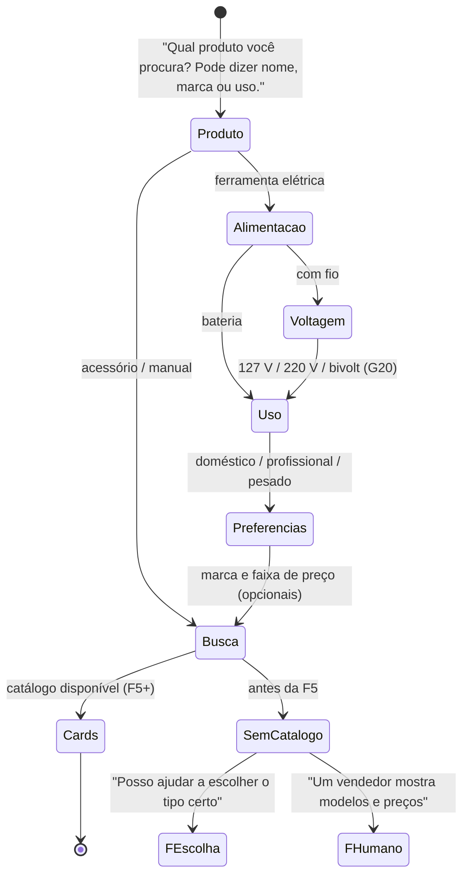

# 0008 — Desenho conversacional do Tork

> **Versão:** 1.0 · **Data:** 2026-11-23 · **Status:** proposta para aprovação do time
> Parte do [plano de profissionalização](0005-Plano-de-Profissionalizacao.md). Voz e tom seguem a [identidade visual](0009-Identidade-Visual.md).
> Base: roteiro de chatbot de loja de ferramentas proposto pelo time + pesquisa sobre o que clientes perguntam e reclamam (fontes no fim).

## 1. Do FAQ ao assistente de loja

O MVP respondia **perguntas soltas**. Clientes de loja de ferramentas também querem **resolver tarefas**:
achar um produto, escolher o certo, acompanhar um pedido, trocar, falar com alguém.
Por isso o Tork passa a ter três modos, que convivem:

| Modo | Quando | Como responde |
|------|--------|---------------|
| **Menu e fluxos guiados** | Cliente clica numa opção ou a intenção é clara ("cadê meu pedido") | Fluxo determinístico (perguntas em sequência, *slots*), sem LLM |
| **FAQ** | Pergunta técnica ou de política ("qual broca para concreto?") | Banco de FAQ revisada (o que já existe) |
| **IA com supervisão** | Pergunta nova que não está no banco | Ollama + guardrails; vira sugestão para aprovação humana |

**Regra de ouro:** tudo que envolve **dado da loja** (preço, estoque, pedido, horário, endereço,
pagamento) vem de **configuração ou integração**, nunca do LLM. Enquanto a integração não existir, o
Tork diz que ainda não consulta aquilo e oferece o caminho certo (link ou atendente).

## 2. O que os clientes mais perguntam e reclamam (pesquisa)

| Achado | Evidência | Consequência no Tork |
|--------|-----------|----------------------|
| **Atraso na entrega** é a reclamação mais frequente em lojas de ferramentas online | ~20% a 26% dos problemas listados no Reclame Aqui de lojas grandes do setor | Fluxo de **pedido/entrega** com prioridade alta, transparente e com saída rápida para humano |
| **Voltagem errada** (127 V × 220 V) gera troca e conflito | Casos recorrentes de produto entregue na voltagem errada | Guardrail **G20**: sempre confirmar a voltagem antes de indicar ferramenta com fio |
| **Garantia não atendida / onde fica a assistência** | Reclamações sobre acionar garantia e falta de assistência | Fluxo de **trocas e garantia** com regras do CDC + localizar assistência autorizada |
| **Compatibilidade de acessórios** ("essa broca/bateria serve na minha?") é um dos principais motivos para ir à loja física | Bosch/SAP: conferir se o acessório serve é razão central da visita | Intenção **compatibilidade**: perguntar marca/modelo; só afirmar com dado validado (F5) |
| **Ajuda no projeto / como fazer** | Assistentes da Home Depot e Lowe's recebem milhões de perguntas de uso e de projeto | Fluxo **ajuda para escolher** e respostas "como fazer" com segurança |
| **Troubleshooting e manutenção** ("está esquentando", "perdeu força") | Categoria comum em bases de intenções de lojas | FAQs de diagnóstico seguro + encaminhar à assistência |
| **Política de troca e devolução** | FAQs de todas as lojas pesquisadas | Respostas baseadas no CDC (abaixo) + política da loja configurável |

### Regras do CDC que o Tork pode citar (orientação geral, não consultoria jurídica)

| Regra | Base | Como o Tork fala |
|-------|------|------------------|
| **Arrependimento em compra online/telefone:** até **7 dias** após o recebimento, sem justificativa, com devolução integral (inclusive frete) | CDC art. 49 | "Em compras feitas fora da loja física, você pode desistir em até 7 dias após receber o produto." |
| **Garantia legal de produto durável:** **90 dias** para reclamar de defeito (somada à garantia do fabricante) | CDC art. 26 | "Além da garantia do fabricante, a lei garante 90 dias para reclamar de defeito em produtos duráveis." |
| **Troca em loja física sem defeito** não é obrigação legal; depende da política da loja | Política própria | "Na loja física, a troca sem defeito segue a política da loja: [link/texto configurado]." |

> O início da contagem dos 90 dias tem interpretações diferentes (entrega × descoberta do vício oculto):
> o Tork **não** calcula prazo de garantia de um caso concreto; orienta e encaminha. Revisar estes
> textos com o responsável jurídico/comercial antes de publicar.

## 3. Catálogo de intenções

| # | Intenção | Exemplos de frase | Resolve com | Disponível em |
|---|----------|-------------------|-------------|---------------|
| I01 | Saudação / menu | "oi", "menu", "opções" | Boas-vindas + menu | F2 |
| I02 | Encontrar produto | "procuro furadeira", "tem esmerilhadeira?" | Fluxo F-PROD (slots) → catálogo | Fluxo F3 · catálogo F5 |
| I03 | Ajuda para escolher | "qual comprar?", "não sei qual pegar" | Fluxo F-ESCOLHA → FAQ/IA → vendedor | F3 |
| I04 | Dúvida técnica | "diferença entre impacto e martelete" | FAQ → IA supervisionada | **Já existe** |
| I05 | Compatibilidade | "essa bateria serve na minha?" | Pergunta marca/modelo → FAQ geral; dado do catálogo validado | Geral já · específico F5 |
| I06 | Voltagem | "minha cidade é 127 ou 220?", "é bivolt?" | FAQ + G20 | F3 |
| I07 | Uso e segurança | "posso usar na chuva?", "qual EPI?" | FAQ (já existe) + alerta | **Já existe** |
| I08 | Manutenção / defeito | "está esquentando", "perdeu força" | FAQ diagnóstico seguro → assistência | F1 (conteúdo) |
| I09 | Garantia e assistência | "como aciono a garantia?", "onde tem assistência?" | Fluxo F-TROCA + `assistencias` | F3 · localizar F5 |
| I10 | Troca e devolução | "quero devolver", "veio voltagem errada" | Fluxo F-TROCA (CDC + política) | F3 |
| I11 | Pedido / entrega | "cadê meu pedido?", "atrasou" | Fluxo F-PEDIDO → integração | Orientação F3 · consulta real F8 |
| I12 | Frete e prazo | "quanto é o frete pra SP?" | Texto configurado → integração | F3 · cálculo real F8 |
| I13 | Pagamento e parcelamento | "parcela?", "aceita pix?" | `politicas` configuradas | F3 |
| I14 | Preço e estoque | "quanto custa?", "tem em estoque?" | Nunca LLM; catálogo/integração | Mensagem segura já · real F8 |
| I15 | Sem estoque / avise-me | "acabou?", "me avisa quando chegar" | Outra unidade / avise-me com consentimento | F8 |
| I16 | Peças de reposição | "vende escova de carvão?" | FAQ → atendente | Já existe (FAQ-050) |
| I17 | Nota fiscal | "preciso da 2ª via da nota" | Orientação → atendente | F3 |
| I18 | Retirada na loja | "posso retirar?" | `unidades` configuradas | F3 |
| I19 | Horário e endereço | "que horas abre?", "onde fica?" | `unidades` configuradas | F3 |
| I20 | Orçamento PJ / atacado | "preciso de 20 furadeiras", "compra com CNPJ" | Encaminha vendedor B2B | F3 |
| I21 | Não sei o nome da ferramenta | "aquela que corta curva" | Descrever o trabalho → FAQ/IA; foto em F9 | Texto F3 · foto F9 |
| I22 | Falar com atendente | "quero falar com alguém", "humano" | Handoff F-HUMANO | F3 |
| I23 | Reclamação / frustração | "absurdo", "ninguém resolve" | Empatia + handoff prioritário | F3 |
| I24 | Elogio / agradecimento | "valeu", "obrigado" | Encerramento + CSAT | F2 |
| I25 | Fora do escopo | "capital da França" | Recusa educada (G05) | **Já existe** |

## 4. Mensagens-padrão (voz do Tork)

> `{loja}`, `{horario}`, `{endereco}` etc. vêm da **configuração da loja** (tabela `unidades`/`politicas`), nunca do LLM.

**Boas-vindas**
> Olá! 👋 Eu sou o Tork, assistente da {loja}. Posso ajudar você a encontrar ferramentas, escolher a certa para o seu trabalho e tirar dúvidas sobre pedidos, pagamento e trocas. Como posso ajudar?

**Menu inicial** (botões; na web com ícones Lucide, no WhatsApp com emoji)

| Botão | Ícone | Leva a |
|-------|-------|--------|
| 🔎 Encontrar um produto | `search` | F-PROD |
| 🛠️ Ajuda para escolher | `wrench` | F-ESCOLHA |
| 📦 Pedido ou entrega | `package` | F-PEDIDO |
| 💳 Pagamento e parcelamento | `credit-card` | I13 |
| 🔁 Trocas e garantia | `refresh-ccw` | F-TROCA *(acrescentado: é das maiores fontes de reclamação)* |
| 👤 Falar com um atendente | `user` | F-HUMANO |

**Encerramento**
> Obrigado por falar com a {loja}! 🔧 Se precisar de mais alguma coisa, é só chamar.
> *Esta conversa ajudou?* 👍 👎   ← CSAT, gravado sem dados pessoais

## 5. Fluxos guiados

Cada fluxo é uma **máquina de estados** com *slots*. O cliente pode sair a qualquer momento
digitando outra coisa ("menu", "atendente") e pode responder em texto livre: o Tork extrai os slots.
Perguntas de esclarecimento: **no máximo 2 por mensagem** (o checklist pede 1–3; 4 de uma vez cansa no celular).

### F-PROD — Encontrar um produto



| Passo | Tork diz |
|-------|----------|
| Produto | "Qual produto você procura? Pode dizer o nome, a marca ou o uso." |
| Alimentação + uso | "Você prefere com fio ou a bateria? E o uso vai ser doméstico, profissional ou pesado?" |
| Voltagem (G20) | "Qual a voltagem da tomada onde vai usar: 127 V, 220 V ou prefere bivolt? Se não souber, confira a etiqueta de um aparelho ou a concessionária de energia." |
| Preferências | "Tem preferência de marca ou uma faixa de preço?" |
| Resultado (F5+) | Cards: nome, especificações principais, voltagem, preço **do sistema**, disponibilidade **do sistema**, link |
| Resultado (antes da F5) | "Ainda não consulto o catálogo por aqui. Posso te ajudar a escolher o tipo certo de ferramenta, ou chamo um vendedor para mostrar modelos e preços. O que prefere?" |

### F-ESCOLHA — Ajuda para escolher

| Passo | Tork diz |
|-------|----------|
| 1 | "Claro! Me conta: o que você vai fazer e em qual material?" |
| 2 | "E com que frequência vai usar? Tem uma faixa de preço em mente?" |
| Resultado | Recomenda **o tipo** de ferramenta e os critérios (FAQ/IA), com segurança. Ex.: "Para furar concreto com frequência, o mais indicado é um martelete com encaixe SDS-plus…" |
| Saída | "Quer que eu mostre opções (F5+) ou prefere falar com um vendedor especializado?" |

### F-PEDIDO — Pedido ou entrega

| Fase | Comportamento |
|------|---------------|
| **Até a F8** (sem integração) | "Ainda não consigo consultar pedidos por aqui. Você acompanha em {link_meus_pedidos}, ou posso chamar um atendente." Se o cliente disser que **atrasou**: empatia + handoff prioritário (I23). |
| **F8** (integração) | Pede **número do pedido** + **um fator de verificação** (e-mail ou CEP de entrega) **num formulário seguro**, não no texto livre. Mostra status e previsão vindos do sistema. Se não localizar: atendente. |

> **Decisão sobre CPF (D024):** o roteiro original pedia "número do pedido **ou CPF**". O Tork **não pede CPF
> no chat aberto**: o G02 mascara CPF digitado. Na F8, se a integração exigir documento, ele é coletado só em
> formulário autenticado, nunca vai para o LLM, para o log nem para o histórico.

### F-TROCA — Trocas e garantia

```mermaid
flowchart TD
    A["Tork: Posso ajudar! É desistência da compra, defeito ou produto errado?"] --> B{Motivo}
    B -- Desistência --> C{Comprou online ou na loja física?}
    C -- Online --> D["Até 7 dias após receber: direito de arrependimento (CDC art. 49)"]
    C -- Loja física --> E["Segue a política da loja: {politica_troca}"]
    B -- Defeito --> F["Garantia legal de 90 dias + garantia do fabricante; leve a nota fiscal à assistência autorizada"]
    F --> G[Localizar assistência F5 / atendente]
    B -- Produto ou voltagem errada --> H["Lamento! Isso é tratado como troca prioritária"] --> I[Handoff com resumo]
    D --> J[Como solicitar: {link_trocas} ou atendente]
    E --> J
```

### F-HUMANO — Falar com um atendente

| Passo | Tork diz |
|-------|----------|
| 1 | "Vou chamar um atendente. Para ele já começar ajudando, me diga em uma frase o que você precisa." |
| 2 (opcional) | "Como prefere ser chamado? (opcional)". **Consentimento (G23):** "Vou compartilhar esse resumo com a nossa equipe para dar continuidade ao atendimento, ok?" |
| Dentro do horário | "Pronto! Um atendente vai continuar por aqui em instantes." |
| Fora do horário | "Nosso atendimento humano funciona {horario_atendimento}. Deixei seu pedido registrado e retornaremos assim que abrir." |

Cria um registro em `atendimentos_humanos` (resumo, motivo, prioridade), sem CPF, sem telefone, salvo se o canal já for autenticado.

## 6. Respostas rápidas

| Tema | Resposta (dados da configuração) | Fase |
|------|-----------------------------------|------|
| Horário | "Funcionamos {dias_horarios}." | F3 |
| Endereço | "Estamos em {endereco}. [Ver no mapa]({link_mapa})" | F3 |
| Trocas | Fluxo F-TROCA | F3 |
| Produto sem estoque | Até F8: "Não consulto estoque por aqui; um atendente verifica outra unidade ou a previsão de chegada." · F8: outra unidade / **avise-me** com consentimento | F3 / F8 |
| Não sei o nome | "Sem problema! Descreva o trabalho que você precisa fazer (ex.: 'cortar azulejo em curva')." · F9: "ou envie uma foto" | F3 / F9 |
| Voltagem da cidade | "Não sei a voltagem da sua cidade com certeza, e ela pode variar até dentro do mesmo município. Confira a etiqueta de um aparelho, a tomada ou a concessionária. Na dúvida, prefira bivolt." | F3 |
| Assistência técnica | Até F5: "Leve o produto e a nota fiscal a uma assistência autorizada do fabricante; um atendente informa a mais próxima." · F5: busca em `assistencias` por cidade | F3 / F5 |

## 7. Regras de escalonamento para humano (G21)

O Tork **oferece** atendente quando:
1. O cliente pede ("atendente", "humano", "pessoa", "vendedor").
2. **Dois fallbacks seguidos** (não entendeu duas vezes) → mostra o menu; no **terceiro**, oferece atendente.
3. Frustração detectada (palavras como "absurdo", "ninguém resolve", "procon", texto todo em maiúsculas).
4. Pedido atrasado, produto errado ou voltagem errada.
5. Risco: conserto de equipamento energizado, instalação elétrica, uso profissional especializado.
6. Orçamento PJ/atacado ou negociação.

E **sempre** mantém o menu acessível ("digite *menu* a qualquer momento").

## 8. Métricas do atendimento

| Métrica | Definição | Meta inicial |
|---------|-----------|--------------|
| Taxa de contenção | Conversas resolvidas sem humano | ≥ 60% |
| Taxa de fallback | Mensagens sem resposta adequada | ≤ 10% |
| Escalonamento | Conversas que foram para humano | Acompanhar (não é ruim por si) |
| CSAT | 👍 ÷ (👍 + 👎) | ≥ 80% |
| Perguntas sem resposta (top 20 da semana) | Insumo para novas FAQs | Revisão semanal |
| Latência p95 | Tempo até a resposta | ≤ 3 s (banco) · ≤ 8 s (IA) |

## Fontes

- Reclame Aqui — [Maxi Ferramentas](https://www.reclameaqui.com.br/empresa/maxi-ferramentas), [Loja do Mecânico](https://www.reclameaqui.com.br/empresa/loja-do-mecanico-loja-online), [voltagem errada (DD Máquinas)](https://www.reclameaqui.com.br/dd-maquinas/maquina-com-a-voltagem-errada_m8m_74iIOp8C7KdL/), [voltagem errada (Casa das Serras)](https://www.reclameaqui.com.br/casa-das-serras/produto-entregue-com-voltagem-erra_1aw0x2K1wr-uogyY/), [garantia (Palácio das Ferramentas)](https://www.reclameaqui.com.br/palacio-das-ferramentas/produto-com-defeito-e-falta-de-assistencia-para-acionar-garantia-em-menos-de-2-meses-apos-a-compra_NtqabL7VG9MwQD2E/)
- FAQs de lojas e marcas — [Vonder](https://www.reclameaqui.com.br/empresa/vonder/faq/), [Maxi Ferramentas](https://www.reclameaqui.com.br/empresa/maxi-ferramentas/faq/), [Loja do Mecânico](https://www.reclameaqui.com.br/empresa/loja-do-mecanico-loja-online/faq/)
- Compatibilidade de acessórios — [SAP News (Bosch)](https://news.sap.com/?p=206425); intenções em lojas de ferragens — [Wonderchat](https://wonderchat.io/blog/ai-chatbot-hardware-stores) (material de fornecedor)
- Assistentes de grandes varejistas — [Customer Experience Dive (Home Depot e Lowe's)](https://www.customerexperiencedive.com/news/home-depot-lowes-ai-assistants-share-common-goal-approaches-differ/832056/)
- CDC — [Idec: prazos de troca](https://idec.org.br/consultas/dicas-e-direitos/voce-sabe-qual-o-prazo-de-troca-de-produtos-estipulado-em-lei), [Jus.com.br: garantia legal e arrependimento](https://jus.com.br/artigos/104322/garantia-legal-e-direito-de-arrependimento)
