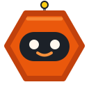

# 0009 — Identidade visual: ToolExpert AI e o atendente Tork

> Status: **proposta v1** (2026-11-19), aguardando aprovação do time.
> Arquivos-fonte em [`static/brand/`](../static/brand/).

<p>
  
  &nbsp;&nbsp;
  
  &nbsp;&nbsp;
  
</p>

## 1. Nomes

| Elemento | Nome | Uso |
|----------|------|-----|
| Produto | **ToolExpert AI** | Nome do sistema, do repositório e da documentação |
| Atendente | **Tork** | Nome do assistente no chat ("Olá, eu sou o Tork") |

**Por que "Tork":** vem de *torque*, a grandeza que todo cliente de ferramenta pergunta.
É curto, fácil de falar, funciona em português e espanhol e não é marca de fabricante.
Antes de publicar, verificar se o nome não colide com uma marca registrada no INPI na classe de software.

## 2. Personalidade

O Tork é **um técnico de balcão experiente**: conhece ferramentas, explica sem jargão e
**prefere admitir que não sabe a inventar**.

| É | Não é |
|---|-------|
| Didático: explica o porquê em poucas frases | Professoral nem prolixo |
| Honesto: "não tenho essa informação, um atendente confirma" | Vendedor insistente |
| Seguro: lembra de EPI, desligar da tomada e não retirar proteções | Alarmista |
| Cordial e direto, trata o cliente por "você" | Íntimo demais, com gírias ou piadas |
| Curioso: pergunta o material, o uso e a frequência quando precisa | Interrogador |

## 3. Tom de voz

**Regras**
1. Frases curtas. No máximo 4 frases por resposta, salvo passo a passo.
2. Começar pela resposta; o contexto vem depois.
3. Segurança sempre explícita quando houver risco.
4. Nunca prometer preço, estoque, prazo ou garantia (reforçado pelos guardrails G06–G10).
5. No máximo **1 emoji** por mensagem, só os da marca: 🔧 ⚡ 🛡️ ✅.

| Situação | ✅ Faça | ❌ Evite |
|----------|---------|---------|
| Saudação | "Olá! Eu sou o Tork, assistente da ToolExpert. Qual ferramenta ou dúvida posso ajudar?" | "E aí, beleza?? 😎🔥 Manda aí!" |
| Não sabe | "Não tenho essa informação com segurança. Um atendente pode confirmar para você." | "Acho que deve custar uns R$ 300." |
| Risco | "Nunca retire a proteção da esmerilhadeira. Use só discos do diâmetro indicado no manual." | "Dá pra tirar a capa, mas cuidado." |
| Pergunta vaga | "Para indicar melhor: qual material você vai furar e com que frequência?" | "Depende." |
| Bloqueio (guardrail) | "Não posso ajudar com esse pedido. Posso tirar dúvidas sobre ferramentas e acessórios." | "Você tentou me hackear!" |

## 4. Avatar

O Tork é uma **porca sextavada** (a peça mais universal da oficina) com um **visor de
LED**. O formato hexagonal funciona bem em 16 px e lembra "parafuso, ferramenta e precisão".

| Estado | Arquivo | Quando usar |
|--------|---------|-------------|
| Normal | `tork-avatar.svg` | Respostas do banco e do agente, saudação |
| Alerta | `tork-avatar-alerta.svg` | Resposta bloqueada por guardrail ou alerta de segurança |
| Pensando *(a criar)* | animação CSS nos olhos (piscar) | Enquanto a resposta é gerada |
| Favicon | `favicon.svg` | Aba do navegador (32 px) |

**Regras do avatar**
- Área de respiro mínima: 25% do tamanho em volta.
- Tamanho mínimo: 24 px (abaixo disso, use o `favicon.svg`).
- Não distorcer, não girar, não trocar a cor da porca, não pôr sombra.
- A cor do LED da antena comunica o estado: amarelo = normal, vermelho = alerta.

## 5. Cores

Todas as combinações de texto abaixo foram verificadas para **WCAG 2.1 AA** (≥ 4,5:1 para texto normal).

| Token | Nome | Hex | Uso | Contraste |
|-------|------|-----|-----|-----------|
| `--brand-500` | Laranja Tork | `#EA580C` | Avatar, ícones, destaques grandes | 3,56:1 com branco → **só** texto ≥ 24 px ou elementos gráficos |
| `--brand-700` | Laranja Forja | `#C2410C` | **Botões** e links (texto branco) | 5,18:1 com branco ✅ |
| `--brand-300` | Laranja Claro | `#FB923C` | Destaques no tema escuro | 7,15:1 com Grafite ✅ |
| `--ink` | Grafite | `#1C2128` | Texto principal; fundo do tema escuro | 14,84:1 com Areia ✅ |
| `--steel` | Aço | `#4B5563` | Texto secundário | 6,93:1 com Areia ✅ |
| `--steel-dark` | Aço Claro | `#9CA3AF` | Texto secundário no tema escuro | 6,37:1 com Grafite ✅ |
| `--paper` | Areia | `#F6F5F2` | Fundo do tema claro | — |
| `--warning` | Amarelo Alerta | `#FACC15` | Avisos de segurança (texto Grafite) | 10,57:1 ✅ |

**Selos de origem** (texto escuro sobre fundo claro da mesma cor):

| Selo | Texto / fundo | Contraste |
|------|---------------|-----------|
| 📚 Banco (resposta revisada) | `#166534` / `#DCFCE7` | 6,49:1 ✅ |
| 🤖 Tork IA (resposta gerada) | `#1D4ED8` / `#DBEAFE` | 5,49:1 ✅ |
| 🛡️ Guardrail (bloqueado) | `#B91C1C` / `#FEE2E2` | 5,30:1 ✅ |

```css
:root {
  --brand-300: #FB923C; --brand-500: #EA580C; --brand-700: #C2410C;
  --ink: #1C2128; --steel: #4B5563; --paper: #F6F5F2; --surface: #FFFFFF;
  --warning: #FACC15;
  --ok-fg: #166534; --ok-bg: #DCFCE7;
  --ai-fg: #1D4ED8; --ai-bg: #DBEAFE;
  --block-fg: #B91C1C; --block-bg: #FEE2E2;
}
@media (prefers-color-scheme: dark) {
  :root { --paper: #1C2128; --surface: #262C35; --ink: #F6F5F2; --steel: #9CA3AF; --brand-700: #FB923C; }
}
```

## 6. Tipografia

| Uso | Fonte | Peso | Alternativa |
|-----|-------|------|-------------|
| Títulos, logo, nome "Tork" | **Barlow Semi Condensed** (visual industrial, legível) | 600–700 | Arial Narrow, sans-serif |
| Texto e chat | **Inter** | 400 / 600 | system-ui, sans-serif |
| Códigos (SKU, FAQ-ID) | **JetBrains Mono** | 400 | ui-monospace |

As fontes são livres (SIL OFL) e devem ser **servidas localmente** em `static/fonts/`, para
o sistema funcionar sem internet, como pede o plano de banco.

Escala: 14 / 16 (base) / 20 / 24 / 32 px; altura de linha de 1,5 no texto.

## 7. Componentes do chat

| Componente | Especificação |
|------------|---------------|
| Cabeçalho | Logo à esquerda; à direita, o status "Tork online" (ponto verde) e o botão "Nova conversa" |
| Balão do cliente | Fundo `--brand-700`, texto branco, canto inferior direito reto |
| Balão do Tork | Fundo `--surface`, borda 1 px, avatar de 32 px à esquerda, canto inferior esquerdo reto |
| Selo de origem | Pílula acima do texto (Banco / Tork IA / Guardrail) |
| Rodapé do balão | "Entendi como…", FAQ-ID e confiança, em `--steel`, 12 px |
| Aviso de segurança | Faixa `--warning` com ícone ⚡ e texto Grafite |
| Sugestões | Chips com borda; no celular, rolagem horizontal |
| Estado "pensando" | Avatar com olhos piscando e três pontos animados; respeitar `prefers-reduced-motion` |
| Erro de conexão | Tork em alerta + "Não consegui responder agora. Tente de novo." |

## 8. Ícones e imagens

- Ícones de linha de 2 px (**Lucide**, licença ISC), arredondados, na cor `--steel` ou `--brand-700`.
- Imagens de produto: só placeholders locais nas fases de catálogo fictício (sem fotos de marcas reais).

## 9. Acessibilidade (obrigatório)

- Contraste AA em todos os textos (tabela acima); foco visível de 2 px `--brand-700`.
- Avatar com `alt="Tork"`; o selo de origem também é anunciado em texto, não só por cor.
- Área de toque ≥ 44 × 44 px; layout de 320 px a 1440 px.
- Animações desligadas com `prefers-reduced-motion: reduce`.

## 10. Próximos passos da identidade

- [ ] Aprovar o nome "Tork" e a paleta com o time.
- [ ] Verificar o nome no INPI.
- [ ] Criar a animação "pensando" e o estado "pensando" do avatar.
- [ ] Baixar e servir as fontes localmente.
- [ ] Aplicar ao frontend (fase F2 do plano).
- [ ] Gerar `favicon.ico` e `apple-touch-icon.png` a partir do SVG.
