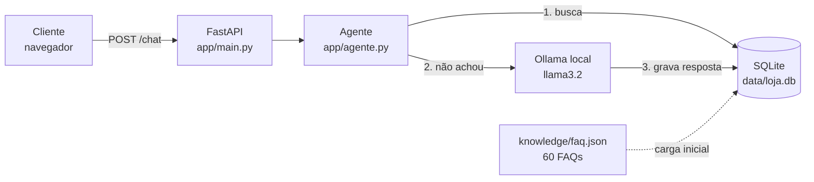
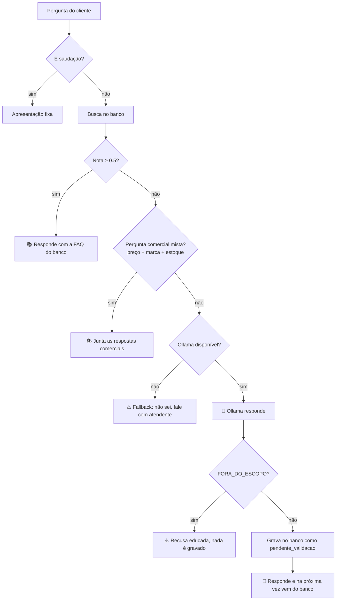
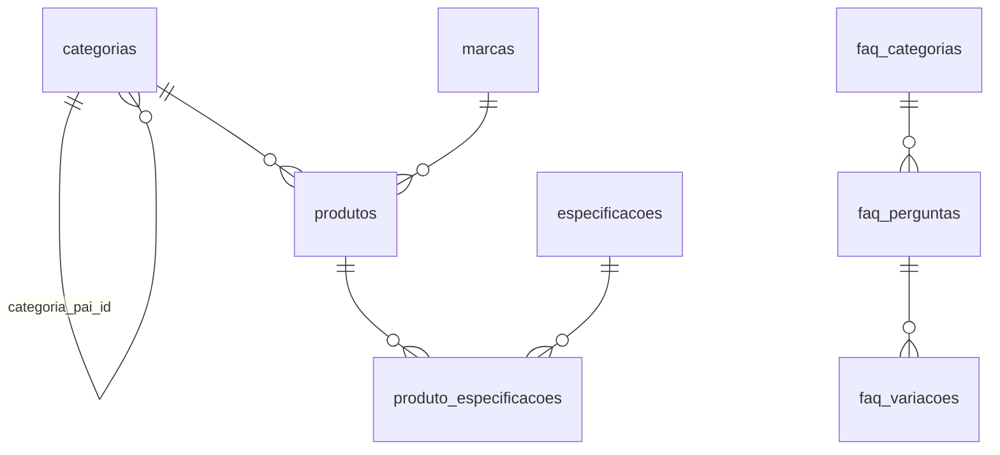

# 0011 — Arquitetura atual (v0.2)

## Visão geral

| Camada | Arquivo | Responsabilidade |
|--------|---------|------------------|
| Interface | `static/index.html` | Página de chat (HTML + CSS + JS puro, sem build) |
| API | `app/main.py` | Rotas HTTP, validação de entrada, tratamento de erros |
| Regras | `app/agente.py` | Decide entre banco, agente de IA ou fallback |
| Busca | `app/busca.py` | Normalização de texto e pontuação das FAQs |
| Dados | `app/banco.py` | Criação do SQLite, carga inicial e gravação de respostas aprendidas |
| Terminal | `agente.py` | Mesma lógica da API, em modo texto |

## Fluxo de uma pergunta

## Contexto da conversa (`app/memoria.py`)

Sem memória, "e para metal?" depois de "Qual broca usar em concreto?" vira só "metal" e cai
em "cortar metal". A solução usada é a **reescrita da pergunta de continuação**:

1. A página gera um `conversationId`; a API guarda em RAM as últimas 5 trocas daquela conversa.
2. `parece_continuacao()` detecta mensagens que dependem da anterior: começam com "e", "mas",
   "então"…; têm pronomes ("isso", "ela", "dele"…); ou têm no máximo 2 palavras relevantes.
3. Só nesse caso o Ollama reescreve a mensagem como pergunta completa
   ("Qual broca é adequada para uso em metal?"). A reescrita passa pelo guardrail G15.
4. A pergunta completa é usada para buscar no banco, para chamar o agente (que também recebe o
   histórico) e para gravar. Assim, **o banco nunca recebe perguntas soltas** como "e para metal?".
5. "Nova conversa" chama `DELETE /conversas/{id}` e gera outro ID.

## Guardrails (`app/guardrails/`)

Proteções em camadas (entrada → escopo → prompt → saída → reescrita → aprendizado).
Catálogo completo G01–G19 em **[0013-Guardrails.md](0013-Guardrails.md)**.

## Algoritmo de busca (`app/busca.py`)

1. **Normalização:** converte para minúsculas, remove acentos, troca `R$` por `reais`, mantém só letras e números.
2. **Tokens:** remove *stopwords* ("qual", "posso", "para"...) e números soltos, e aplica um plural simples ("brocas" → "broca", "padrões" → "padrão").
3. **Pontuação de cada FAQ:**
   - palavra da pergunta que aparece nas `palavras_chave` da FAQ: **1,0**;
   - palavra que aparece só no texto da pergunta ou das `variacoes`: **0,6**;
   - nota = soma ÷ total de palavras da pergunta (de 0 a 1);
   - pergunta idêntica à pergunta cadastrada ou a uma variação: **1,0** direto.
4. **Erros de digitação:** palavras com 5 letras ou mais são comparadas com `difflib` (semelhança ≥ 0,84), então "parafuzadeira" casa com "parafusadeira".
5. **Desempate:** a FAQ comercial vem primeiro (para nunca parecer que informamos preço) e, depois, a que cobriu mais palavras-chave.

| Limiar | Valor | Efeito |
|--------|-------|--------|
| `NOTA_MINIMA` | 0,5 | Abaixo disso a pergunta "não existe" no banco e vai para o agente |
| `NOTA_CONFIANTE` | 0,75 | Abaixo disso a resposta termina pedindo mais detalhes |
| `MARGEM_EMPATE` | 0,1 | Se a 2ª FAQ ficar perto da 1ª, ela é sugerida ("Talvez também ajude") |

## Modelo de dados atual (SQLite)

Tabela única `faq`, criada por `app/banco.py`:

| Coluna | Tipo | Descrição |
|--------|------|-----------|
| `id` | TEXT PK | `FAQ-001`... (as aprendidas continuam a sequência: `FAQ-061`...) |
| `categoria` | TEXT | Ex.: `brocas_discos_acessorios`, `atendimento_comercial`, `aprendida` |
| `pergunta` | TEXT | Pergunta principal |
| `variacoes` | TEXT (JSON) | Outras formas de fazer a mesma pergunta |
| `palavras_chave` | TEXT (JSON) | Termos que identificam o assunto |
| `resposta` | TEXT | Resposta enviada ao cliente |
| `fonte` | TEXT | Origem do conteúdo (`docs/...` ou `ollama`) |
| `status` | TEXT | `rascunho`, `pendente_validacao`, `validado` ou `inativo` |
| `origem` | TEXT | `seed` (carga inicial) ou `agente` (aprendida) |
| `criado_em` | TEXT | Data e hora ISO |

## Modelo de dados futuro (`sql/0001-estrutura.sql`)

Esquema relacional em **PostgreSQL** já esboçado para as próximas versões (catálogo
de produtos e FAQ normalizada). **Ele não é usado pelo MVP 1**, que roda em SQLite.
`sql/0002-consultabaseconhecimento.sql` traz uma consulta de exemplo (busca com `ILIKE`
na pergunta e nas variações), também em sintaxe PostgreSQL.

## Segurança e privacidade

- Entrada validada: mensagem de 1 a 500 caracteres; mensagem vazia ou só com espaços é rejeitada (HTTP 422).
- Erros inesperados devolvem uma mensagem genérica, sem stack trace.
- O log registra só o ID da FAQ, a nota e a origem, nunca o texto do cliente.
- O LLM roda **localmente** (Ollama): nenhum dado sai da máquina.
- O prompt do LLM proíbe inventar preço, estoque, prazo ou garantia e proíbe pedir CPF, endereço ou pagamento.
- CORS não é necessário: a página é servida pela própria API (mesma origem).

## Limitações conhecidas

- **O llama3.2 (3B) pode errar conteúdo técnico.** Por isso toda resposta aprendida fica como `pendente_validacao` e precisa de revisão humana.
- A busca por palavras-chave não entende sinônimos que não estejam cadastrados.
- Não há limite de requisições (rate limit) nem autenticação.
- O histórico de conversa fica só em memória: some quando a API reinicia (intencional no MVP).
- Cada continuação reescrita custa uma chamada extra ao Ollama (~0,3 a 1 s).
- A primeira chamada ao Ollama demora de 10 a 12 s (carregamento do modelo).
