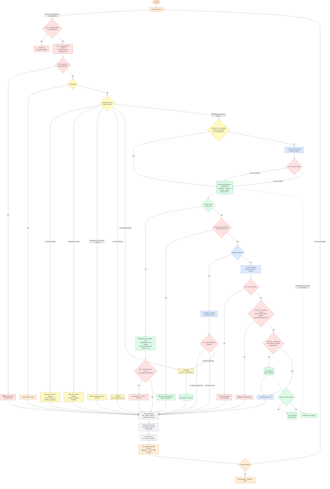
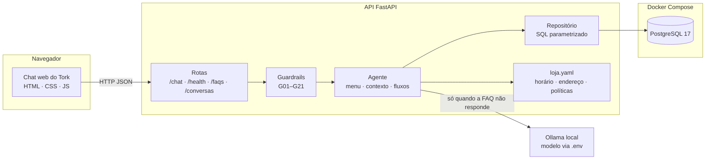
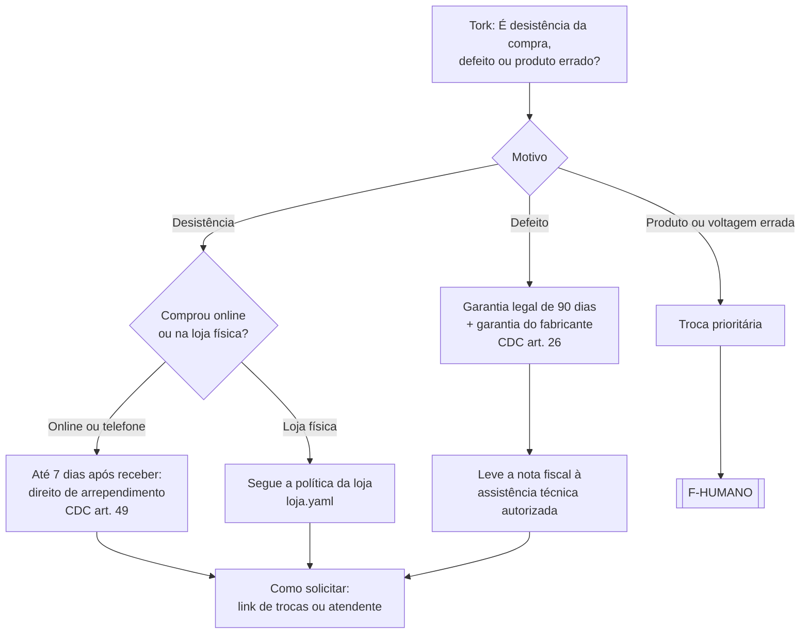
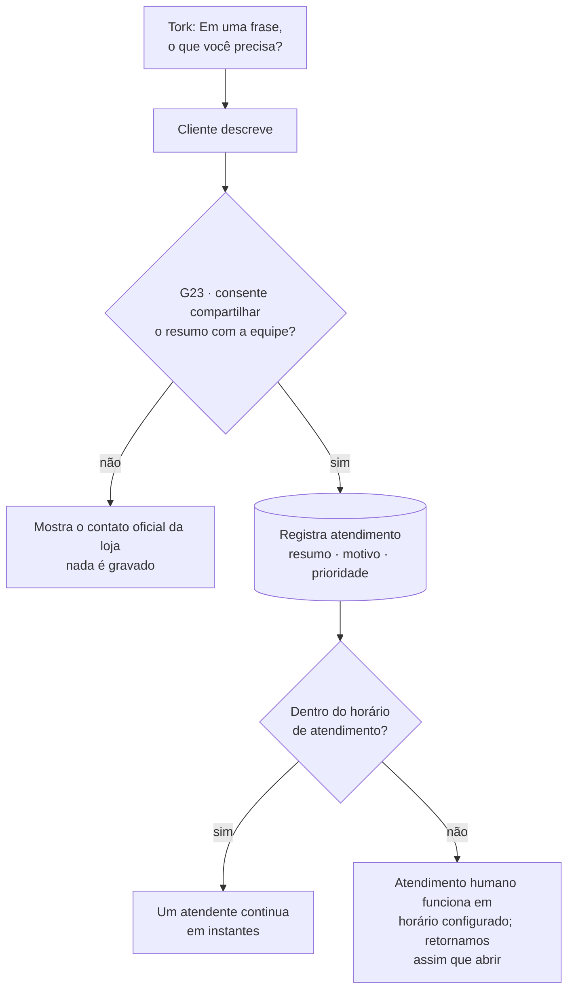
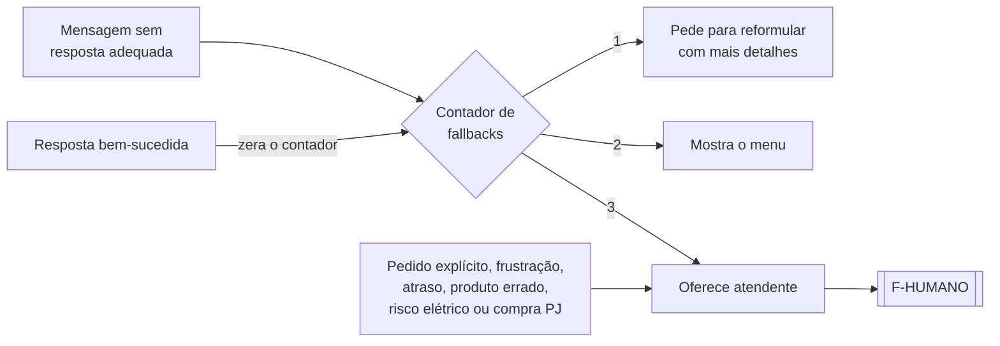
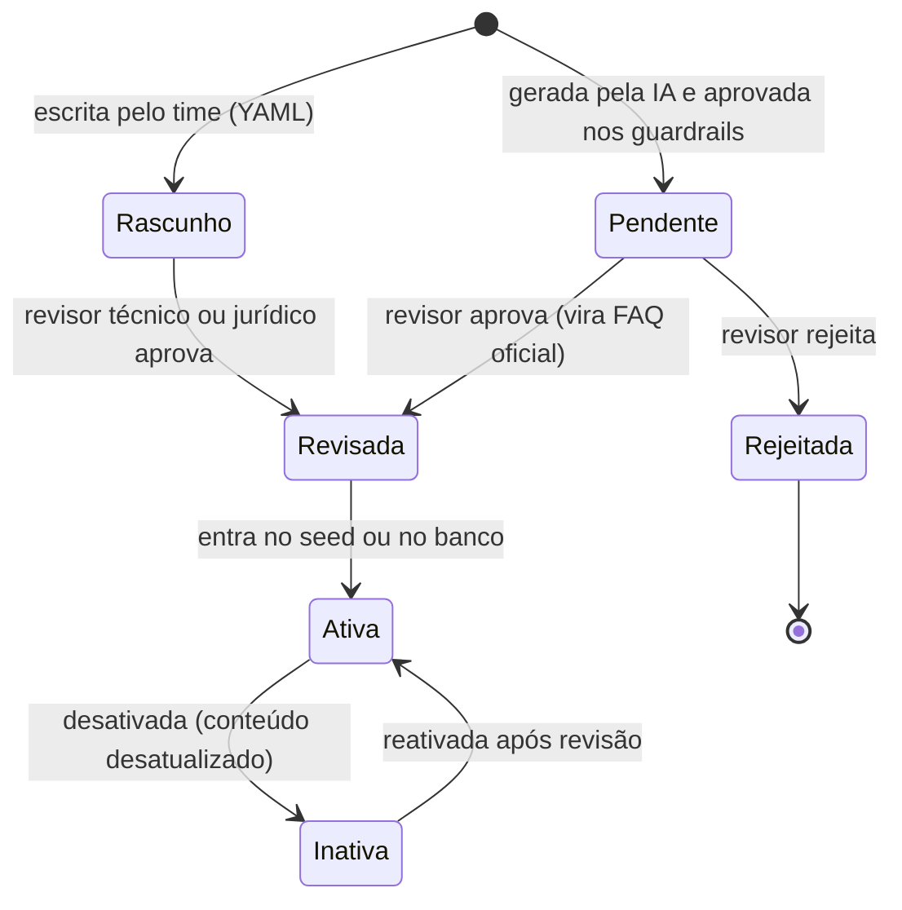
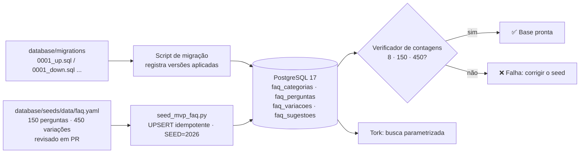
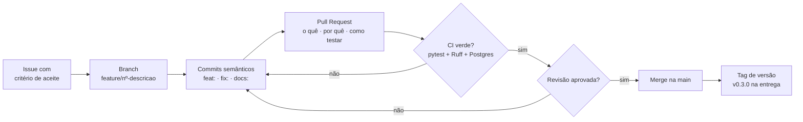
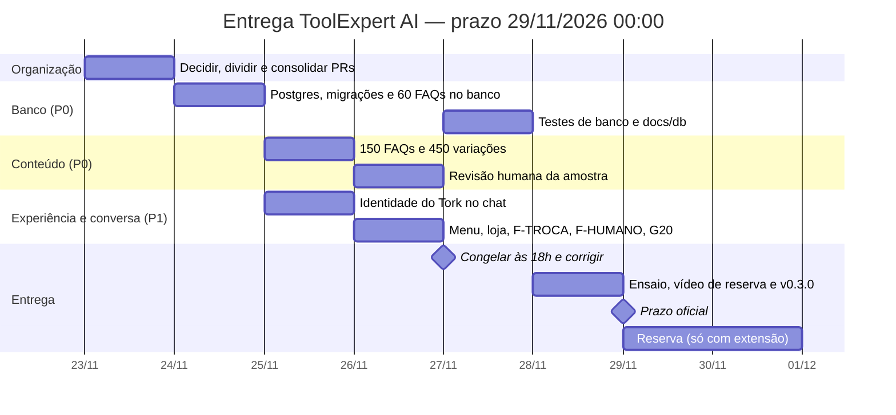

# 0019 — Fluxograma do sistema

> **Versão:** 1.0 · **Data:** 2026-11-23 · **Escopo:** o Tork como será entregue em 29/11 ([`0018`](0018-Plano-de-Entrega-29-11.md), itens P0 e P1).
> Os diagramas usam [Mermaid](https://mermaid.js.org/) e aparecem renderizados no GitHub e no VS Code (com extensão de preview Mermaid).

## Legenda de cores

| Cor | Significado |
|-----|-------------|
| 🟧 Laranja | Cliente e interface |
| 🟥 Vermelho | Guardrail (proteção) |
| 🟩 Verde | Banco de dados e respostas revisadas |
| 🟦 Azul | Inteligência artificial (Ollama) |
| 🟨 Amarelo | Dados configurados da loja e fluxos guiados |
| ⬜ Cinza | Montagem da resposta, memória e métricas |

---

## 1. Fluxograma completo: o caminho de uma mensagem

---

## 2. Visão de componentes

---

## 3. Fluxos guiados

### 3.1 F-TROCA: trocas e garantia

### 3.2 F-HUMANO: falar com um atendente

### 3.3 Escada de fallback e escalonamento (G21)

---

## 4. Ciclo de vida de uma resposta

---

## 5. Dados: do YAML ao PostgreSQL

---

## 6. Fluxo de trabalho do time

---

## 7. Cronograma da entrega

