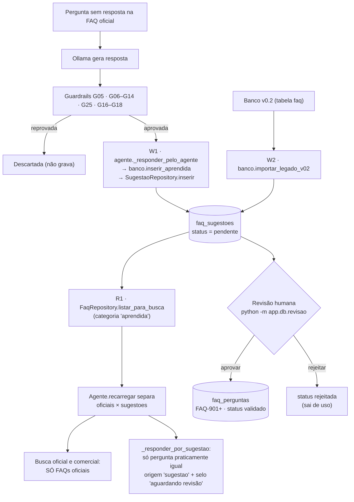

# 0020 — Revisão técnica: evidências

> Evidências da **revisão técnica adicional** (RT-001 a RT-014) definida em
> [`0007-Tasks-Reinicio-do-Projeto.md`](0007-Tasks-Reinicio-do-Projeto.md#revisão-técnica-adicional--confiabilidade-do-tork-23112026).
> Este documento **não** é uma lista paralela de tarefas: as tasks e seus `[x]` continuam no `0007`; aqui ficam
> comando, ambiente, resultado e arquivos afetados de cada item.

## Ambiente de referência

| Item | Valor |
|------|-------|
| Sistema | Windows 11 (10.0.26200) |
| Python | 3.14.0 (`.venv` do projeto) |
| SQLite | 3.50.4, `sqlite3.threadsafety = 3` (modo *serialized*) |
| Bibliotecas | fastapi 0.165.0 · starlette 1.10.0 · pydantic 2.14.3 · uvicorn 0.54.0 · pytest 9.2.0 · httpx 0.28.1 · httpx2 2.16.2 · ollama 0.6.3 |
| Modelo LLM | `llama3.2` (3B) no Ollama local |

---

## RT-005 — Execução da suíte de testes

**Data:** 2026-11-24 · **Commit:** `24efdf3`

```powershell
.venv\Scripts\python -m pytest -q            # 729 passed in 6.96s
.venv\Scripts\python -X dev -m pytest -q     # 729 passed in 7.85s (modo de desenvolvimento: todos os avisos ligados)
```

| Arquivo | Testes |
|---------|------:|
| `tests/test_faq_json.py` | 224 |
| `tests/test_guardrails.py` | 180 |
| `tests/test_banco.py` | 86 |
| `tests/test_agente.py` | 62 |
| `tests/test_intencoes.py` | 50 |
| `tests/test_busca.py` | 48 |
| `tests/test_contexto.py` | 38 |
| `tests/test_api.py` | 23 |
| `tests/test_frontend_e_cli.py` | 18 |
| **Total** | **729** |

- **Falhas:** 0. **Avisos:** 0.
- `pytest.ini` usa `filterwarnings = error`: qualquer depreciação nova quebra a suíte.
- Achado da própria execução (24/11): com avisos como erro apareceram `ResourceWarning: unclosed database` em testes
  que abriam conexões SQLite sem fechar. Corrigido com a fixture `conexoes` (fecha tudo ao fim de cada teste).
- Os testes não dependem do Ollama: o modelo é substituído por um falso (`tests/conftest.py::OllamaFalso`).

---

## RT-006 — Integridade do SQLite e das migrações

**Data:** 2026-11-24

| Verificação | Banco novo | Banco real `data/loja.db` (somente leitura) |
|-------------|-----------|---------------------------------------------|
| `PRAGMA integrity_check` | `ok` | `ok` |
| `PRAGMA foreign_key_check` | 0 violações | 0 violações |
| Migrações aplicadas | 0001–0005 | 0001–0005 |
| Seeds idempotentes (2 execuções extras) | contagens idênticas, 0 divergências | — |
| Rollback total + reaplicação | ✅ (após correção abaixo) | não executado (preservar dados) |

**Achado e correção:** o rollback só era testado em banco **vazio**. Num banco **populado**, `0003_catalogo.down.sql`
falhava com `FOREIGN KEY constraint failed`: `categorias` referencia a si mesma com `RESTRICT` e o `DROP TABLE` apaga as
linhas uma a uma. Correção: desfazer a hierarquia (`UPDATE categorias SET categoria_pai_id = NULL`) antes do `DROP`.
Novos testes: `test_integridade_do_banco_populado` e `test_rollback_e_reaplicacao_com_banco_populado`.

Observação do banco real: 7 sugestões da IA com status `pendente` (incluindo a resposta incorreta `SUG-0006` sobre
parafusos brocantes) e a tabela `legado_faq_v02` preservada (65 linhas).

**Arquivos:** `database/migrations/0003_catalogo.down.sql`, `tests/test_banco.py`.

---

## RT-001 — Auditoria do ciclo de sugestões e aprendizado

**Data:** 2026-11-24

### Mapa do fluxo



| Ponto | Onde | Comportamento verificado |
|-------|------|--------------------------|
| Grava (W1) | `app/agente.py` → `app/banco.py` → `SugestaoRepository.inserir` | Só depois dos guardrails de saída, incerteza (G25) e aprendizado (G16–G18) |
| Grava (W2) | `banco.importar_legado_v02` | Importa respostas aprendidas da v0.2 como **pendentes**; a tabela antiga é renomeada, não apagada |
| Lê (R1) | `FaqRepository.listar_para_busca` | Sugestões entram com categoria `aprendida` e status `pendente_validacao` |
| Serve | `Agente._responder_por_sugestao` | Origem `sugestao` (nunca `banco`), selo próprio, só com nota ≥ 0,9 e ≥ 75% das palavras |
| Promove | `SugestaoRepository.aprovar` (só via `app/db/revisao.py`) | Exige ação humana; cria FAQ `validado` |

### Achados

1. **Já corrigido antes da auditoria (PR #5):** sugestões pendentes eram buscadas como FAQ oficial e apareciam com o
   selo "Banco de dados" (caso "brocantes/blocantes").
2. **Novo achado, corrigido agora:** a FAQ aprovada recebia o próximo código livre (ex.: `FAQ-062`). Ao acrescentar
   FAQs no `knowledge/faq.json`, o seed (upsert por código) **sobrescreveria a FAQ aprovada pelo revisor**.
   Agora as aprovadas usam a faixa própria `FAQ-901+`.
3. **Não há promoção automática:** só dois pontos do código inserem em `faq_perguntas`: o seed (arquivo versionado)
   e a aprovação humana (teste `test_rt001_unicos_pontos_que_inserem_na_faq_oficial`).

### Testes que demonstram o comportamento real

| Teste | Prova |
|-------|-------|
| `test_agente.py::test_rt001_sugestao_pendente_nunca_tem_origem_banco` (5 variantes) | Sugestão pendente nunca sai como `banco` |
| `test_agente.py::test_sugestao_nao_responde_pergunta_diferente_com_palavra_parecida` | Caso real "brocantes/blocantes" |
| `test_banco.py::test_rt001_faq_aprovada_nao_e_sobrescrita_pelo_seed` | Aprovada sobrevive à sincronização do seed |
| `test_banco.py::test_rt001_segunda_aprovacao_continua_a_faixa` | FAQ-901, FAQ-902… |
| `test_banco.py::test_rt001_unicos_pontos_que_inserem_na_faq_oficial` | Só seed e aprovação inserem na FAQ oficial |
| `test_banco.py::test_rejeitar_sugestao_tira_da_busca` / `test_aprovar_sugestao_vira_faq_oficial` | Ciclo de revisão |

**Arquivos:** `app/db/repositorios.py`, `tests/test_banco.py`, `tests/test_agente.py`.

---

## RT-007 — Concorrência no acesso ao SQLite

**Data:** 2026-11-24

### Inspeção

| Recurso compartilhado | Antes | Risco |
|-----------------------|-------|-------|
| Conexão SQLite | **Uma única** `sqlite3.Connection` (`check_same_thread=False`) usada por todas as threads do FastAPI | Cursores e cache de comandos interferem entre threads |
| Listas de FAQ do agente | `recarregar()` reatribuía três listas em sequência | Uma thread poderia ver listas de versões diferentes |
| Memória de conversas | `OrderedDict` sem trava | `move_to_end`/`popitem` concorrentes |

### Medição (8 threads × 40 operações: gravar sugestão, gravar avaliação, ler catálogo, responder pela FAQ)

| | Antes | Depois |
|---|---|---|
| Operações concluídas | 295 / 320 | **960 / 960** (3 rodadas) |
| Erros | **25** (`InterfaceError: bad parameter or other API misuse` ×17, `IndexError` ×4, `DatabaseError: no more rows available` ×2, `SystemError`, `OperationalError`) | **0** |
| Avaliações gravadas | 78 de 80 | 240 de 240 |
| `PRAGMA integrity_check` | ok | ok |

### Correção

- `app/db/conexao.py`: `ConexoesPorThread`, uma conexão por thread para o mesmo arquivo, e `busy_timeout = 5000 ms`
  (a escrita espera a vez em vez de falhar). O `Agente` do servidor usa o pool; testes e terminal continuam com uma conexão única.
- `app/agente.py`: repositórios criados por chamada (com a conexão da thread); `recarregar()` monta as listas e as publica de uma vez.
- `app/memoria.py`: trava (`threading.Lock`) em todas as operações.

### Cenário de carga HTTP (uvicorn, 1 processo, sem LLM, cópia do banco real)

| Usuários simultâneos | Requisições | Vazão | p50 | p95 | Máx | Status |
|---------------------:|------------:|------:|----:|----:|----:|--------|
| 10 | 100 | 144 req/s | 32 ms | 173 ms | 200 ms | 80 × 200, 20 × 204 |
| 30 | 300 | 136 req/s | 61 ms | 667 ms | 1.190 ms | 240 × 200, 60 × 204 |

Mix: 60% `/chat` (FAQ, catálogo, loja), 20% `POST /avaliacoes` (escrita), 20% `GET /produtos`. Avaliações gravadas: 80 de 80; integridade ok.

### Limites operacionais (documentados)

| Limite | Consequência | Recomendação |
|--------|--------------|--------------|
| SQLite aceita **um escritor por vez** | Escritas concorrentes esperam até 5 s (`busy_timeout`) | Suficiente para demonstração e loja pequena; PostgreSQL se houver muitas escritas simultâneas (RT-013) |
| Memória de conversa fica **no processo** | Com mais de um processo (`--workers N`), o contexto se perde entre requisições | Rodar com **1 processo** (padrão); a fase de histórico persistente (B-03) resolve |
| **Ollama** atende poucas gerações em paralelo | Perguntas novas simultâneas ficam em fila (vários segundos cada) | Respostas do banco não dependem do Ollama; ver RT-010 para os tempos |
| Busca em Python é CPU-bound | p95 sobe para ~0,7 s com 30 usuários simultâneos | Aceitável para a demo; índice/embeddings só com ganho medido (RT-009) |

**Testes:** `tests/test_concorrencia.py` (leituras e escritas simultâneas sem erro, uma conexão por thread, memória concorrente).
**Arquivos:** `app/db/conexao.py`, `app/agente.py`, `app/memoria.py`, `tests/test_concorrencia.py`.

---

## RT-010 — Indisponibilidade e lentidão do Ollama

**Data:** 2026-11-24

### Medição antes da correção

| Cenário | Comportamento |
|---------|---------------|
| Ollama desligado (porta fechada) | `ConnectionError` em 2,2 s → fallback |
| **Ollama travado** (aceita a conexão e não responde) | **requisição pendurada indefinidamente**: o cliente `ollama` não tem timeout por padrão (`timeout=None`) |

### Correção

- `app/agente.py`: o Ollama é chamado por `ollama.Client(host, timeout)`:
  - geração: `OLLAMA_TIMEOUT` (padrão **45 s**, porque a 1ª chamada carrega o modelo);
  - reescrita de contexto: `OLLAMA_TIMEOUT_REESCRITA` (padrão **10 s**; se passar, segue com a pergunta original);
  - `OLLAMA_HOST` opcional; valores inválidos voltam ao padrão.
- Qualquer falha (timeout, conexão, resposta vazia) vira **fallback com mensagem clara**:
  *"No momento não consegui consultar a inteligência artificial do Tork. Posso responder perguntas da nossa base
  (produtos, preços de demonstração, horários e dúvidas técnicas comuns) ou chamar um atendente da loja."*,
  com o guardrail `ia:indisponivel`. O log registra só o tipo do erro, nunca a pergunta.
- Respostas do banco (FAQ, catálogo, loja) **não dependem do Ollama** e continuam funcionando com ele fora do ar.

### Medição com o Ollama real (`llama3.2`, 3B)

| Situação | Tempo |
|----------|-------|
| 1ª chamada (modelo frio, carregando) | 4,7 s nesta medição (11,7 s na primeira sessão de 19/11) |
| Chamadas seguintes (modelo quente) | média 1,1 s · máx 1,5 s (5 perguntas) |
| Memória do modelo carregado | 2,6 GB (100% GPU); descarregado após 5 min sem uso |

Recomendação para a demonstração: fazer uma pergunta de aquecimento antes de começar (já está no roteiro `0015`).

### Testes

`tests/test_agente.py`: `test_rt010_timeout_configuravel_por_variavel`, `test_rt010_timeout_invalido_usa_padrao`,
`test_rt010_reescrita_tem_timeout_curto`, `test_rt010_falha_do_ollama_vira_fallback_claro` (timeout, conexão, rede) e
`test_rt010_ollama_travado_nao_trava_o_atendimento` (servidor que nunca responde: o atendimento termina em ~1 s).

**Arquivos:** `app/agente.py`, `app/guardrails/prompts.py`, `tests/test_agente.py`.

---

## RT-008 — Conjunto de avaliação com 100 perguntas

**Data:** 2026-11-24 · **Arquivos:** `tests/eval/conjunto_avaliacao.json` (perguntas + gabarito), `tests/eval/avaliar.py`
(executor), `docs/eval/avaliacao-roteamento.md` (relatório gerado).

```powershell
.venv\Scripts\python -m tests.eval.avaliar --relatorio
```

- **100 perguntas novas**, redigidas de forma diferente das FAQs e variações cadastradas: 35 de FAQ direta, 15 com
  sinônimos e erros de digitação, 10 ambíguas, 10 sem resposta na base, 15 comerciais e 15 críticas de segurança.
- **Método:** a IA generativa é substituída por um marcador, e mede-se *para onde* cada pergunta vai (FAQ certa,
  catálogo, loja, fallback ou IA). É determinístico e repetível. A qualidade do texto gerado pela IA é medida à parte (T-048).
- **Resposta perigosa:** pergunta comercial ou de segurança que seria respondida pela IA sem verificação, ou resposta
  com trecho proibido (ex.: "pode retirar" a proteção).
- **Gabarito:** montado pelo assistente de IA e **pendente de revisão humana** (T-025). Não é afirmada precisão além da medida.

### Linha de base (antes das correções de RT-003 e da busca)

| Grupo | Acerto |
|-------|--------|
| FAQ direta | 28/35 |
| Sinônimos e erros | 15/15 |
| Ambíguas | 10/10 |
| Sem resposta (não responder com FAQ errada) | 8/10 |
| Comerciais | 15/15 |
| Segurança | 9/15 |
| **Total** | **85/100** |
| **Respostas perigosas** | **5** |

Relatório completo da linha de base: [`docs/eval/avaliacao-roteamento-linha-de-base.md`](eval/avaliacao-roteamento-linha-de-base.md).

**Principais achados:**
1. **5 perguntas de segurança fora da base iriam para a IA** (caneta detectora "garante" energia desligada, ferramenta
   soltando fumaça, luva perto de serra girando, abrir bateria de lítio, trocar tomada energizada) → motiva a RT-003.
2. **Falsos positivos da busca:** "trocar o óleo do carro" → FAQ de troca de produto; "tinta para parede úmida" → FAQ de
   remover tinta.
3. **Variações de verbo não reconhecidas:** "escolho" × "escolher", "conservo" × "conservar", "tiro" × "tirar" e
   "5Ah" × "Ah" fizeram perguntas de FAQ caírem abaixo do limite.

---

## RT-003 — Política de respostas técnicas de risco (guardrail G26)

**Data:** 2026-11-24 · **Arquivos:** `app/guardrails/risco.py`, `app/agente.py`, `app/busca.py`, `app/db/repositorios.py`

### Catálogo de temas de risco

| Tema | Exemplos detectados |
|------|---------------------|
| Eletricidade | tomada, fiação, energia, choque, disjuntor, quadro de luz, rede/instalação elétrica |
| Solda | soldar, eletrodo, máscara de solda, arco elétrico |
| Discos e corte | disco, esmerilhadeira, rebolo, serra circular/mármore |
| Proteções | proteção, capa de proteção, sem óculos, luvas |
| Baterias de lítio | lítio, bateria inchada/estufada/danificada, abrir a bateria, células |
| Superaquecimento | fumaça, queimado, faísca, superaquecendo |
| Químicos | solvente, decapante, ácido, thinner |

### Política

1. Pergunta com FAQ forte (nota ≥ 0,5) → responde pela FAQ (as FAQs de risco já orientam com segurança).
2. **Ação perigosa** (abrir bateria/carregador, mexer com energia ligada, "gato", retirar proteção *para* fazer algo)
   → sempre **encaminhamento** (manual, profissional habilitado, atendente).
3. Tema de risco com FAQ parcial (nota ≥ 0,3) **marcada como risco médio ou alto** → responde pela FAQ + reforço
   *"confira sempre o manual do fabricante e, na dúvida, procure um profissional habilitado"*.
4. Sem FAQ adequada → encaminhamento. **Nunca** consulta a IA nem reaproveita sugestões não revisadas.

### Resultado medido (conjunto RT-008)

| | Linha de base | Após G26 |
|---|---|---|
| Respostas perigosas | **5** | **0** |
| Segurança (gabarito) | 9/15 | 12/15 (os 3 restantes caem em encaminhamento seguro ou FAQ vizinha; tratados na ampliação de conteúdo) |
| Acerto geral | 85/100 | 88/100 |

### Testes

- `tests/test_guardrails.py`: detecção dos 7 temas, perguntas comuns sem falso alarme, ações perigosas e perguntas
  *sobre a regra* (ex.: "posso retirar a proteção?") que não são ação perigosa.
- `tests/test_agente.py`: perguntas de risco sem base são encaminhadas **sem chamar a IA**; risco com FAQ próxima
  responde com reforço; sugestão pendente não responde tema de risco.
- `tests/test_avaliacao.py`: a avaliação de 100 perguntas roda em toda execução da suíte e exige **0 respostas perigosas**.

**Revisão humana pendente:** os cenários críticos (catálogo de temas e textos de encaminhamento) precisam ser
validados por um responsável técnico (T-004/T-025) antes de uso real.

---

## RT-002 — Promoção de conhecimento não revisado

**Data:** 2026-11-24 · **Depende de:** RT-001

**Conclusão da auditoria:** **não existe promoção automática.** Só o seed (arquivo versionado) e a aprovação humana
(`python -m app.db.revisao aprovar`) inserem na FAQ oficial (teste `test_rt001_unicos_pontos_que_inserem_na_faq_oficial`).
O risco que existia era outro: sugestões pendentes *servidas* como se fossem FAQ, corrigido na PR #5 e auditado na RT-001.

### Estados

| Estado sugerido na RT-002 | Estado no banco (`faq_sugestoes.status`) | Como chega lá |
|---------------------------|------------------------------------------|---------------|
| `PENDENTE` | `pendente` | Gravada pela IA após os guardrails, ou importada da v0.2 |
| `EM_REVISAO` | — (não criado) | Ver decisão abaixo |
| `APROVADA` | `aprovada` (+ `faq_pergunta_id` obrigatório, por `CHECK`) | `revisao aprovar` → cria FAQ `FAQ-901+` com status `validado` |
| `REJEITADA` | `rejeitada` (+ motivo, revisor, data) | `revisao rejeitar` |

**Decisão (D029):** não criar `EM_REVISAO` agora. Com um revisor usando o comando de terminal, a revisão é atômica
(aprova ou rejeita na hora); o estado só faz sentido com o painel admin (T-050) e vários revisores. Quando necessário:
migração `0006` recriando a tabela com o novo valor no `CHECK` (o SQLite não altera `CHECK`), mantendo os registros
existentes (`pendente`/`aprovada`/`rejeitada` mapeiam 1:1).

### Controle adicional

`TORK_SERVIR_SUGESTOES=false` desliga o reaproveitamento de respostas não revisadas: só conteúdo aprovado é servido,
e perguntas novas voltam a ir para a IA (que grava nova sugestão para revisão). Padrão: `true` (demonstra o
aprendizado), sempre com selo "aguardando revisão" e **nunca** para temas de risco (G26).

**Testes:** `test_rt002_desligar_sugestoes_serve_so_conteudo_aprovado`, `test_rt003_sugestao_pendente_nao_responde_tema_de_risco`
e os testes da RT-001.

---

## RT-004 — Origem e incerteza de cada resposta

**Data:** 2026-11-24

**Achado:** a origem já era diferenciada, mas a interface dizia "📚 Banco de dados · **resposta revisada**", e as FAQs
estão com status `rascunho` (nenhuma revisada por especialista). Era uma afirmação falsa.

**Correção:** cada resposta traz `statusConteudo`, gravado também no log (sem a pergunta do cliente):

| Origem | `statusConteudo` | O que a interface mostra |
|--------|------------------|--------------------------|
| `banco` | status da FAQ: `rascunho`, `pendente_validacao` ou `validado` | Selo "📚 Base de conhecimento" + "conteúdo ainda não revisado por especialista" se não for `validado` |
| `catalogo`, `loja` | `dados_demonstracao` | "dados fictícios de demonstração" |
| `agente`, `sugestao` | `gerado_por_ia` | "Tork IA · resposta gerada, ainda não revisada" / "aguardando revisão" |
| `fallback`, `bloqueado`, `saudacao`, `fora_do_escopo` | — | Selo próprio; não é especificação técnica |

**Testes:** `test_rt004_status_do_conteudo_por_origem` (5 origens), `test_rt004_faq_validada_aparece_como_validada`,
`test_rt004_fallback_e_bloqueio_nao_tem_status_de_conteudo`, `test_rt004_interface_nao_afirma_revisao_que_nao_houve`.

**Arquivos:** `app/agente.py`, `app/main.py`, `static/js/chat.js`, testes.

## RT-008 — Reavaliação após a ampliação da base (P0.4, 2026-11-24)

| Etapa | Acertos | Perigosas |
|---|---|---|
| Linha de base | 85/100 | 5 |
| G26 (política de risco) | 88/100 | 0 |
| Radical verbal + filtro comercial | 90/100 | 0 |
| **150 FAQs / 452 variações** | **95/100** | **0** |

- **Arquivos:** `knowledge/faq.json`, `database/seeds/ampliar_faq_2026_11_24.py`, `tests/eval/conjunto_avaliacao.json`, `tests/test_avaliacao.py` (ACERTO_MINIMO 90 → 93), testes que usavam "soprador térmico"/"tupia de bancada" como tema **desconhecido** (agora cobertos pela base: trocados por "aerógrafo"/"rebitadeira").
- **Testes:** `pytest -q` → 1409 passed; `python -m tests.eval.avaliar --relatorio` → `docs/eval/avaliacao-roteamento.md`.
- **Colisões evitadas:** palavras-chave que capturavam perguntas de outros assuntos foram removidas: "fraca" casava com "França", "desistir da compra" com "qual comprar?", "ion litio" com "bateria de lítio inchada", "127v em 220v" com "220 na tomada 110".
- **Gabarito alterado em 2 itens** (AV-020 aceita FAQ-086 SDS; AV-100 aceita FAQ-102 máscara de solda): as novas FAQs respondem essas perguntas diretamente. A alteração está anotada em `nota_revisao` de cada item e deve ser confirmada pelo revisor humano.
- **Risco de sobreajuste:** as perguntas da avaliação **não** foram copiadas para as FAQs; ainda assim, a base e o conjunto foram escritos pela mesma equipe/IA. Um conjunto de validação escrito por terceiros é recomendado antes de tirar conclusões além da demo.
- **Erros restantes:** AV-006, AV-011, AV-012, AV-022 (vão para a IA: paráfrases não cobertas, ex.: "lisinha", "tiro ferrugem") e AV-067 (falso positivo "tinta/umidade" → FAQ-012).
