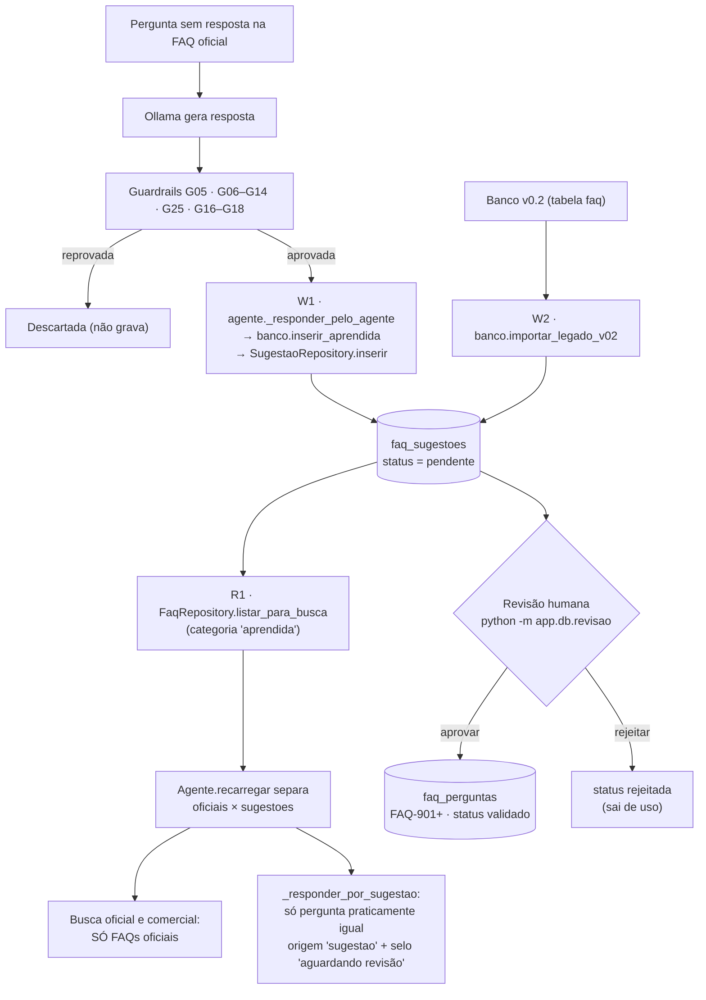

# 0020 — Revisão técnica: evidências

> Evidências da **revisão técnica adicional** (RT-001 a RT-014) definida em
> [`0007-Tasks-Reinicio-do-Projeto.md`](0007-Tasks-Reinicio-do-Projeto.md#revisão-técnica-adicional--confiabilidade-do-tork-23112026).
> Este documento **não** é uma lista paralela de tarefas: as tasks e seus `[x]` continuam no `0007`; aqui ficam
> comando, ambiente, resultado e arquivos afetados de cada item.

## Ambiente de referência

| Item | Valor |
|------|-------|
| Sistema | Windows 11 (10.0.26200) |
| Python | 3.14.0 (`.venv` do projeto) |
| SQLite | 3.50.4, `sqlite3.threadsafety = 3` (modo *serialized*) |
| Bibliotecas | fastapi 0.165.0 · starlette 1.10.0 · pydantic 2.14.3 · uvicorn 0.54.0 · pytest 9.2.0 · httpx 0.28.1 · httpx2 2.16.2 · ollama 0.6.3 |
| Modelo LLM | `llama3.2` (3B) no Ollama local |

---

## RT-005 — Execução da suíte de testes

**Data:** 2026-11-24 · **Commit:** `24efdf3`

```powershell
.venv\Scripts\python -m pytest -q            # 729 passed in 6.96s
.venv\Scripts\python -X dev -m pytest -q     # 729 passed in 7.85s (modo de desenvolvimento: todos os avisos ligados)
```

| Arquivo | Testes |
|---------|------:|
| `tests/test_faq_json.py` | 224 |
| `tests/test_guardrails.py` | 180 |
| `tests/test_banco.py` | 86 |
| `tests/test_agente.py` | 62 |
| `tests/test_intencoes.py` | 50 |
| `tests/test_busca.py` | 48 |
| `tests/test_contexto.py` | 38 |
| `tests/test_api.py` | 23 |
| `tests/test_frontend_e_cli.py` | 18 |
| **Total** | **729** |

- **Falhas:** 0. **Avisos:** 0.
- `pytest.ini` usa `filterwarnings = error`: qualquer depreciação nova quebra a suíte.
- Achado da própria execução (24/11): com avisos como erro apareceram `ResourceWarning: unclosed database` em testes
  que abriam conexões SQLite sem fechar. Corrigido com a fixture `conexoes` (fecha tudo ao fim de cada teste).
- Os testes não dependem do Ollama: o modelo é substituído por um falso (`tests/conftest.py::OllamaFalso`).

---

## RT-006 — Integridade do SQLite e das migrações

**Data:** 2026-11-24

| Verificação | Banco novo | Banco real `data/loja.db` (somente leitura) |
|-------------|-----------|---------------------------------------------|
| `PRAGMA integrity_check` | `ok` | `ok` |
| `PRAGMA foreign_key_check` | 0 violações | 0 violações |
| Migrações aplicadas | 0001–0005 | 0001–0005 |
| Seeds idempotentes (2 execuções extras) | contagens idênticas, 0 divergências | — |
| Rollback total + reaplicação | ✅ (após correção abaixo) | não executado (preservar dados) |

**Achado e correção:** o rollback só era testado em banco **vazio**. Num banco **populado**, `0003_catalogo.down.sql`
falhava com `FOREIGN KEY constraint failed`: `categorias` referencia a si mesma com `RESTRICT` e o `DROP TABLE` apaga as
linhas uma a uma. Correção: desfazer a hierarquia (`UPDATE categorias SET categoria_pai_id = NULL`) antes do `DROP`.
Novos testes: `test_integridade_do_banco_populado` e `test_rollback_e_reaplicacao_com_banco_populado`.

Observação do banco real: 7 sugestões da IA com status `pendente` (incluindo a resposta incorreta `SUG-0006` sobre
parafusos brocantes) e a tabela `legado_faq_v02` preservada (65 linhas).

**Arquivos:** `database/migrations/0003_catalogo.down.sql`, `tests/test_banco.py`.

---

## RT-001 — Auditoria do ciclo de sugestões e aprendizado

**Data:** 2026-11-24

### Mapa do fluxo



| Ponto | Onde | Comportamento verificado |
|-------|------|--------------------------|
| Grava (W1) | `app/agente.py` → `app/banco.py` → `SugestaoRepository.inserir` | Só depois dos guardrails de saída, incerteza (G25) e aprendizado (G16–G18) |
| Grava (W2) | `banco.importar_legado_v02` | Importa respostas aprendidas da v0.2 como **pendentes**; a tabela antiga é renomeada, não apagada |
| Lê (R1) | `FaqRepository.listar_para_busca` | Sugestões entram com categoria `aprendida` e status `pendente_validacao` |
| Serve | `Agente._responder_por_sugestao` | Origem `sugestao` (nunca `banco`), selo próprio, só com nota ≥ 0,9 e ≥ 75% das palavras |
| Promove | `SugestaoRepository.aprovar` (só via `app/db/revisao.py`) | Exige ação humana; cria FAQ `validado` |

### Achados

1. **Já corrigido antes da auditoria (PR #5):** sugestões pendentes eram buscadas como FAQ oficial e apareciam com o
   selo "Banco de dados" (caso "brocantes/blocantes").
2. **Novo achado, corrigido agora:** a FAQ aprovada recebia o próximo código livre (ex.: `FAQ-062`). Ao acrescentar
   FAQs no `knowledge/faq.json`, o seed (upsert por código) **sobrescreveria a FAQ aprovada pelo revisor**.
   Agora as aprovadas usam a faixa própria `FAQ-901+`.
3. **Não há promoção automática:** só dois pontos do código inserem em `faq_perguntas`: o seed (arquivo versionado)
   e a aprovação humana (teste `test_rt001_unicos_pontos_que_inserem_na_faq_oficial`).

### Testes que demonstram o comportamento real

| Teste | Prova |
|-------|-------|
| `test_agente.py::test_rt001_sugestao_pendente_nunca_tem_origem_banco` (5 variantes) | Sugestão pendente nunca sai como `banco` |
| `test_agente.py::test_sugestao_nao_responde_pergunta_diferente_com_palavra_parecida` | Caso real "brocantes/blocantes" |
| `test_banco.py::test_rt001_faq_aprovada_nao_e_sobrescrita_pelo_seed` | Aprovada sobrevive à sincronização do seed |
| `test_banco.py::test_rt001_segunda_aprovacao_continua_a_faixa` | FAQ-901, FAQ-902… |
| `test_banco.py::test_rt001_unicos_pontos_que_inserem_na_faq_oficial` | Só seed e aprovação inserem na FAQ oficial |
| `test_banco.py::test_rejeitar_sugestao_tira_da_busca` / `test_aprovar_sugestao_vira_faq_oficial` | Ciclo de revisão |

**Arquivos:** `app/db/repositorios.py`, `tests/test_banco.py`, `tests/test_agente.py`.
