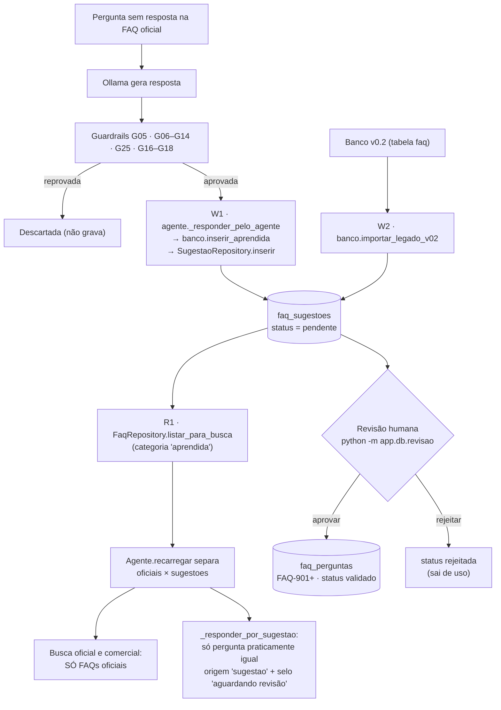

# 0020 — Revisão técnica: evidências

> Evidências da **revisão técnica adicional** (RT-001 a RT-014) definida em
> [`0007-Tasks-Reinicio-do-Projeto.md`](0007-Tasks-Reinicio-do-Projeto.md#revisão-técnica-adicional--confiabilidade-do-tork-23112026).
> Este documento **não** é uma lista paralela de tarefas: as tasks e seus `[x]` continuam no `0007`; aqui ficam
> comando, ambiente, resultado e arquivos afetados de cada item.

## Ambiente de referência

| Item | Valor |
|------|-------|
| Sistema | Windows 11 (10.0.26200) |
| Python | 3.14.0 (`.venv` do projeto) |
| SQLite | 3.50.4, `sqlite3.threadsafety = 3` (modo *serialized*) |
| Bibliotecas | fastapi 0.165.0 · starlette 1.10.0 · pydantic 2.14.3 · uvicorn 0.54.0 · pytest 9.2.0 · httpx 0.28.1 · httpx2 2.16.2 · ollama 0.6.3 |
| Modelo LLM | `llama3.2` (3B) no Ollama local |

---

## RT-005 — Execução da suíte de testes

**Data:** 2026-11-24 · **Commit:** `24efdf3`

```powershell
.venv\Scripts\python -m pytest -q            # 729 passed in 6.96s
.venv\Scripts\python -X dev -m pytest -q     # 729 passed in 7.85s (modo de desenvolvimento: todos os avisos ligados)
```

| Arquivo | Testes |
|---------|------:|
| `tests/test_faq_json.py` | 224 |
| `tests/test_guardrails.py` | 180 |
| `tests/test_banco.py` | 86 |
| `tests/test_agente.py` | 62 |
| `tests/test_intencoes.py` | 50 |
| `tests/test_busca.py` | 48 |
| `tests/test_contexto.py` | 38 |
| `tests/test_api.py` | 23 |
| `tests/test_frontend_e_cli.py` | 18 |
| **Total** | **729** |

- **Falhas:** 0. **Avisos:** 0.
- `pytest.ini` usa `filterwarnings = error`: qualquer depreciação nova quebra a suíte.
- Achado da própria execução (24/11): com avisos como erro apareceram `ResourceWarning: unclosed database` em testes
  que abriam conexões SQLite sem fechar. Corrigido com a fixture `conexoes` (fecha tudo ao fim de cada teste).
- Os testes não dependem do Ollama: o modelo é substituído por um falso (`tests/conftest.py::OllamaFalso`).

---

## RT-006 — Integridade do SQLite e das migrações

**Data:** 2026-11-24

| Verificação | Banco novo | Banco real `data/loja.db` (somente leitura) |
|-------------|-----------|---------------------------------------------|
| `PRAGMA integrity_check` | `ok` | `ok` |
| `PRAGMA foreign_key_check` | 0 violações | 0 violações |
| Migrações aplicadas | 0001–0005 | 0001–0005 |
| Seeds idempotentes (2 execuções extras) | contagens idênticas, 0 divergências | — |
| Rollback total + reaplicação | ✅ (após correção abaixo) | não executado (preservar dados) |

**Achado e correção:** o rollback só era testado em banco **vazio**. Num banco **populado**, `0003_catalogo.down.sql`
falhava com `FOREIGN KEY constraint failed`: `categorias` referencia a si mesma com `RESTRICT` e o `DROP TABLE` apaga as
linhas uma a uma. Correção: desfazer a hierarquia (`UPDATE categorias SET categoria_pai_id = NULL`) antes do `DROP`.
Novos testes: `test_integridade_do_banco_populado` e `test_rollback_e_reaplicacao_com_banco_populado`.

Observação do banco real: 7 sugestões da IA com status `pendente` (incluindo a resposta incorreta `SUG-0006` sobre
parafusos brocantes) e a tabela `legado_faq_v02` preservada (65 linhas).

**Arquivos:** `database/migrations/0003_catalogo.down.sql`, `tests/test_banco.py`.

---

## RT-001 — Auditoria do ciclo de sugestões e aprendizado

**Data:** 2026-11-24

### Mapa do fluxo



| Ponto | Onde | Comportamento verificado |
|-------|------|--------------------------|
| Grava (W1) | `app/agente.py` → `app/banco.py` → `SugestaoRepository.inserir` | Só depois dos guardrails de saída, incerteza (G25) e aprendizado (G16–G18) |
| Grava (W2) | `banco.importar_legado_v02` | Importa respostas aprendidas da v0.2 como **pendentes**; a tabela antiga é renomeada, não apagada |
| Lê (R1) | `FaqRepository.listar_para_busca` | Sugestões entram com categoria `aprendida` e status `pendente_validacao` |
| Serve | `Agente._responder_por_sugestao` | Origem `sugestao` (nunca `banco`), selo próprio, só com nota ≥ 0,9 e ≥ 75% das palavras |
| Promove | `SugestaoRepository.aprovar` (só via `app/db/revisao.py`) | Exige ação humana; cria FAQ `validado` |

### Achados

1. **Já corrigido antes da auditoria (PR #5):** sugestões pendentes eram buscadas como FAQ oficial e apareciam com o
   selo "Banco de dados" (caso "brocantes/blocantes").
2. **Novo achado, corrigido agora:** a FAQ aprovada recebia o próximo código livre (ex.: `FAQ-062`). Ao acrescentar
   FAQs no `knowledge/faq.json`, o seed (upsert por código) **sobrescreveria a FAQ aprovada pelo revisor**.
   Agora as aprovadas usam a faixa própria `FAQ-901+`.
3. **Não há promoção automática:** só dois pontos do código inserem em `faq_perguntas`: o seed (arquivo versionado)
   e a aprovação humana (teste `test_rt001_unicos_pontos_que_inserem_na_faq_oficial`).

### Testes que demonstram o comportamento real

| Teste | Prova |
|-------|-------|
| `test_agente.py::test_rt001_sugestao_pendente_nunca_tem_origem_banco` (5 variantes) | Sugestão pendente nunca sai como `banco` |
| `test_agente.py::test_sugestao_nao_responde_pergunta_diferente_com_palavra_parecida` | Caso real "brocantes/blocantes" |
| `test_banco.py::test_rt001_faq_aprovada_nao_e_sobrescrita_pelo_seed` | Aprovada sobrevive à sincronização do seed |
| `test_banco.py::test_rt001_segunda_aprovacao_continua_a_faixa` | FAQ-901, FAQ-902… |
| `test_banco.py::test_rt001_unicos_pontos_que_inserem_na_faq_oficial` | Só seed e aprovação inserem na FAQ oficial |
| `test_banco.py::test_rejeitar_sugestao_tira_da_busca` / `test_aprovar_sugestao_vira_faq_oficial` | Ciclo de revisão |

**Arquivos:** `app/db/repositorios.py`, `tests/test_banco.py`, `tests/test_agente.py`.

---

## RT-007 — Concorrência no acesso ao SQLite

**Data:** 2026-11-24

### Inspeção

| Recurso compartilhado | Antes | Risco |
|-----------------------|-------|-------|
| Conexão SQLite | **Uma única** `sqlite3.Connection` (`check_same_thread=False`) usada por todas as threads do FastAPI | Cursores e cache de comandos interferem entre threads |
| Listas de FAQ do agente | `recarregar()` reatribuía três listas em sequência | Uma thread poderia ver listas de versões diferentes |
| Memória de conversas | `OrderedDict` sem trava | `move_to_end`/`popitem` concorrentes |

### Medição (8 threads × 40 operações: gravar sugestão, gravar avaliação, ler catálogo, responder pela FAQ)

| | Antes | Depois |
|---|---|---|
| Operações concluídas | 295 / 320 | **960 / 960** (3 rodadas) |
| Erros | **25** (`InterfaceError: bad parameter or other API misuse` ×17, `IndexError` ×4, `DatabaseError: no more rows available` ×2, `SystemError`, `OperationalError`) | **0** |
| Avaliações gravadas | 78 de 80 | 240 de 240 |
| `PRAGMA integrity_check` | ok | ok |

### Correção

- `app/db/conexao.py`: `ConexoesPorThread`, uma conexão por thread para o mesmo arquivo, e `busy_timeout = 5000 ms`
  (a escrita espera a vez em vez de falhar). O `Agente` do servidor usa o pool; testes e terminal continuam com uma conexão única.
- `app/agente.py`: repositórios criados por chamada (com a conexão da thread); `recarregar()` monta as listas e as publica de uma vez.
- `app/memoria.py`: trava (`threading.Lock`) em todas as operações.

### Cenário de carga HTTP (uvicorn, 1 processo, sem LLM, cópia do banco real)

| Usuários simultâneos | Requisições | Vazão | p50 | p95 | Máx | Status |
|---------------------:|------------:|------:|----:|----:|----:|--------|
| 10 | 100 | 144 req/s | 32 ms | 173 ms | 200 ms | 80 × 200, 20 × 204 |
| 30 | 300 | 136 req/s | 61 ms | 667 ms | 1.190 ms | 240 × 200, 60 × 204 |

Mix: 60% `/chat` (FAQ, catálogo, loja), 20% `POST /avaliacoes` (escrita), 20% `GET /produtos`. Avaliações gravadas: 80 de 80; integridade ok.

### Limites operacionais (documentados)

| Limite | Consequência | Recomendação |
|--------|--------------|--------------|
| SQLite aceita **um escritor por vez** | Escritas concorrentes esperam até 5 s (`busy_timeout`) | Suficiente para demonstração e loja pequena; PostgreSQL se houver muitas escritas simultâneas (RT-013) |
| Memória de conversa fica **no processo** | Com mais de um processo (`--workers N`), o contexto se perde entre requisições | Rodar com **1 processo** (padrão); a fase de histórico persistente (B-03) resolve |
| **Ollama** atende poucas gerações em paralelo | Perguntas novas simultâneas ficam em fila (vários segundos cada) | Respostas do banco não dependem do Ollama; ver RT-010 para os tempos |
| Busca em Python é CPU-bound | p95 sobe para ~0,7 s com 30 usuários simultâneos | Aceitável para a demo; índice/embeddings só com ganho medido (RT-009) |

**Testes:** `tests/test_concorrencia.py` (leituras e escritas simultâneas sem erro, uma conexão por thread, memória concorrente).
**Arquivos:** `app/db/conexao.py`, `app/agente.py`, `app/memoria.py`, `tests/test_concorrencia.py`.

---

## RT-010 — Indisponibilidade e lentidão do Ollama

**Data:** 2026-11-24

### Medição antes da correção

| Cenário | Comportamento |
|---------|---------------|
| Ollama desligado (porta fechada) | `ConnectionError` em 2,2 s → fallback |
| **Ollama travado** (aceita a conexão e não responde) | **requisição pendurada indefinidamente**: o cliente `ollama` não tem timeout por padrão (`timeout=None`) |

### Correção

- `app/agente.py`: o Ollama é chamado por `ollama.Client(host, timeout)`:
  - geração: `OLLAMA_TIMEOUT` (padrão **45 s**, porque a 1ª chamada carrega o modelo);
  - reescrita de contexto: `OLLAMA_TIMEOUT_REESCRITA` (padrão **10 s**; se passar, segue com a pergunta original);
  - `OLLAMA_HOST` opcional; valores inválidos voltam ao padrão.
- Qualquer falha (timeout, conexão, resposta vazia) vira **fallback com mensagem clara**:
  *"No momento não consegui consultar a inteligência artificial do Tork. Posso responder perguntas da nossa base
  (produtos, preços de demonstração, horários e dúvidas técnicas comuns) ou chamar um atendente da loja."*,
  com o guardrail `ia:indisponivel`. O log registra só o tipo do erro, nunca a pergunta.
- Respostas do banco (FAQ, catálogo, loja) **não dependem do Ollama** e continuam funcionando com ele fora do ar.

### Medição com o Ollama real (`llama3.2`, 3B)

| Situação | Tempo |
|----------|-------|
| 1ª chamada (modelo frio, carregando) | 4,7 s nesta medição (11,7 s na primeira sessão de 19/11) |
| Chamadas seguintes (modelo quente) | média 1,1 s · máx 1,5 s (5 perguntas) |
| Memória do modelo carregado | 2,6 GB (100% GPU); descarregado após 5 min sem uso |

Recomendação para a demonstração: fazer uma pergunta de aquecimento antes de começar (já está no roteiro `0015`).

### Testes

`tests/test_agente.py`: `test_rt010_timeout_configuravel_por_variavel`, `test_rt010_timeout_invalido_usa_padrao`,
`test_rt010_reescrita_tem_timeout_curto`, `test_rt010_falha_do_ollama_vira_fallback_claro` (timeout, conexão, rede) e
`test_rt010_ollama_travado_nao_trava_o_atendimento` (servidor que nunca responde: o atendimento termina em ~1 s).

**Arquivos:** `app/agente.py`, `app/guardrails/prompts.py`, `tests/test_agente.py`.
