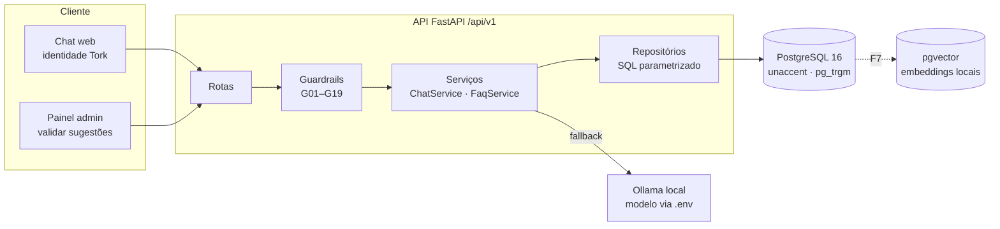
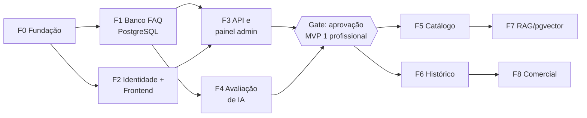

# ToolExpert AI — Plano de profissionalização

> **Versão:** 1.0 · **Data:** 2026-11-19 · **Status:** proposta para aprovação do time
> **Substitui** o planejamento do MVP 1 e **integra** dois documentos:
> - [`TASKS_AGENTE_LOJA_FERRAMENTAS.md`](TASKS_AGENTE_LOJA_FERRAMENTAS.md): produto, comportamento e FAQ
> - [`PLANO_EXECUCAO_BANCO_TOOLEXPERT_AI.md`](PLANO_EXECUCAO_BANCO_TOOLEXPERT_AI.md): banco PostgreSQL (seções citadas como **DB §n**)
>
> Identidade visual: [`identidade-visual.md`](identidade-visual.md).

---

## 1. Onde estamos (diagnóstico)

O MVP demonstrado funciona: o Tork responde pelo banco, usa o Ollama quando a pergunta é nova e aprende. Para virar um produto profissional, faltam as peças abaixo.

| Área | Hoje (v0.2) | Lacuna para o nível profissional |
|------|-------------|----------------------------------|
| Banco | SQLite com uma tabela `faq` desnormalizada (variações e palavras-chave em JSON) | PostgreSQL 16, 3FN, migrações versionadas com rollback (DB §2) |
| Base de conhecimento | 60 FAQs, ~1 variação cada | 150 FAQs + 450 variações revisadas (DB §6) |
| Esquema SQL | `sql/0001–0003` escritos à mão, sem timestamps, índices, unicidades nem rollback; `0003` usa `VECTOR(1536)` (tamanho de embedding da OpenAI) | Migrações completas; dimensão do vetor compatível com o modelo **local** |
| Configuração | Variáveis soltas em `os.getenv` | `pydantic-settings`, `.env` ignorado, `DATABASE_URL` |
| Qualidade | 572 testes pytest; sem lint, sem CI | Ruff, mypy, pre-commit, GitHub Actions com Postgres, cobertura ≥ 85% |
| API | Rotas na raiz, sem versão, sem rate limit | `/api/v1`, modelo de erro padrão, rate limit, CORS restrito, health com dependências |
| Frontend | HTML único funcional, sem marca | Identidade **Tork**, componentes, acessibilidade AA, testes e2e |
| IA | Modelo padrão divergente (`llama3.2` na main, `qwen2.5:3b` em branch); sem avaliação objetiva | Conjunto-ouro de avaliação, comparação de modelos, prompts versionados |
| Memória de conversa | Só em RAM | Tabelas `conversas`/`mensagens` com retenção e anonimização (DB §4) |
| Operação | Roda na máquina de quem desenvolve | Docker Compose (API + Postgres + Ollama), papéis com privilégio mínimo, backup (DB §9) |
| Processo | Commits e PRs semânticos; trabalho em 3 pessoas sem combinados | Fluxo de branches, templates, revisão obrigatória, milestones por fase |

### Pendências do repositório (resolver primeiro)

1. **O commit `004c45e` (contexto + guardrails) não está na `main`:** a PR #1 foi mergeada antes dele.
2. **A branch `feat/modelo-qwen2.5-3b`** (colaborador) troca o modelo padrão para `qwen2.5:3b`, mas foi criada a partir da `main` antiga: vai conflitar com o `004c45e`. Além disso, o `qwen2.5:3b` não está instalado em todas as máquinas, e a mensagem do commit está em espanhol (a convenção é pt-BR).
3. **O `README.md` local tem um link para um Google Docs pessoal** que não foi commitado; decidir se ele deve ser público.

---

## 2. Visão e princípios

**Visão:** o Tork é o atendente técnico da ToolExpert. Ele tira dúvidas sobre ferramentas com respostas revisadas, aprende com perguntas novas sob supervisão humana e nunca inventa preço, estoque ou compatibilidade.

**Princípios (valem para todas as fases):**
1. **Banco primeiro, IA depois.** Resposta revisada vence resposta gerada.
2. **Humano no circuito.** O que a IA cria entra como *sugestão* e só vira FAQ depois de aprovado.
3. **Segurança por camadas.** Guardrails de entrada, escopo, saída e aprendizado (G01–G19) são parte do produto.
4. **Privacidade por padrão.** Dados pessoais mascarados, LLM local, retenção mínima.
5. **Reprodutível.** `docker compose up` + `make seed` + `make test` dão o mesmo resultado em qualquer máquina, sem internet.
6. **Nada é "feito" sem evidência.** Teste passando, log de execução e checklist atualizado (DB §0).

---

## 3. Decisões para aprovar

Cada decisão tem uma recomendação. Depois de aprovada, ela vira registro em [`decisions.md`](decisions.md).

| # | Decisão | Recomendação | Alternativas | Motivo |
|---|---------|--------------|--------------|--------|
| D008 | Ferramenta de migração (DB §0) | **Alembic com SQL explícito** (`op.execute`), um arquivo por versão, com `upgrade` e `downgrade` | SQL puro com runner próprio; yoyo-migrations | O projeto é Python; o Alembic é o padrão do ecossistema, tem rollback testável e mantém o SQL legível ("SQL versionado") |
| D009 | Acesso ao banco | **psycopg 3 + consultas SQL parametrizadas** numa camada `repositories/` | SQLAlchemy ORM | DB §7 pede consultas parametrizadas e explícitas; menos mágica, mais fácil de auditar |
| D010 | Onde ficam as respostas aprendidas | **Nova tabela `faq_sugestoes`** (pendentes); só viram `faq_perguntas` após aprovação | Colunas `status` e `origem` em `faq_perguntas` | Mantém a FAQ oficial "limpa" (3FN) e permite **privilégio mínimo**: o usuário da aplicação só lê a FAQ e só insere sugestões (DB §9) |
| D011 | Busca no Postgres | **`unaccent` + `pg_trgm` + `ILIKE`**, com índice trigram e a pontuação atual por palavra-chave | Full-text search (`tsvector`) | Atende "acentos e maiúsculas" (DB §8) e erros de digitação; o FTS fica para a fase de RAG |
| D012 | Modelo LLM padrão | **Escolher pelo conjunto-ouro** (F4) entre `llama3.2:3b` e `qwen2.5:3b`; até lá, o modelo vem só do `.env` | Fixar `qwen2.5:3b` agora | Decisão com dado, não com preferência; evita quebrar máquinas sem o modelo |
| D013 | Dimensão do `pgvector` (`sql/0003`) | **Definir pelo modelo de embedding local** (ex.: `nomic-embed-text` = 768) e adiar para a F7 | Manter 1536 | 1536 é o tamanho da OpenAI; com Ollama local não funciona. E DB §7 proíbe pgvector no MVP do banco |
| D014 | "Sem LLM nesta fase" (DB §7) × LLM já demonstrado | O DB §7 vale para a **camada de banco** (repositório e consultas não chamam IA). O agente continua usando o Ollama como fallback, atrás da flag `USAR_OLLAMA` | Desligar o LLM | Preserva o que foi demonstrado sem violar o plano de banco |
| D015 | Frontend | **Manter HTML/CSS/JS sem build** na F2, organizado em módulos (`static/js/`, `static/css/`), com a identidade Tork | Next.js/React | Equipe pequena, prazo curto; a troca para React só se justificar painel admin complexo (reavaliar na F3) |
| D016 | Fluxo de branches | **GitHub Flow**: `main` protegida + branches `feature/`, `fix/`, `docs/`, `chore/` + PR com 1 revisão e CI verde | Git Flow com `develop` | Menos cerimônia para 3 pessoas; deploy contínuo é possível |
| D017 | Idioma | **Código, commits, PRs e docs em pt-BR** (identificadores sem acento) | Inglês | Já é o padrão do repositório; o colaborador hispanofalante escreve em pt-BR ou recebe ajuste na revisão |
| D018 | Nome do atendente | **Tork**, do produto **ToolExpert AI** (ver identidade visual) | — | Ver `identidade-visual.md` |

---

## 4. Arquitetura alvo



### Estrutura do repositório alvo

```
toolexpert-ai/
├─ app/
│  ├─ api/v1/            rotas (chat, faq, sugestoes, health)
│  ├─ core/              config (pydantic-settings), logging, erros
│  ├─ guardrails/        G01–G19 (já existe)
│  ├─ services/          chat_service.py, faq_service.py, contexto
│  ├─ repositories/      faq_repository.py, sugestao_repository.py (SQL parametrizado)
│  ├─ llm/               cliente Ollama, prompts versionados
│  └─ main.py
├─ database/
│  ├─ migrations/        Alembic (versions/0001_faq.py ...)
│  ├─ seeds/             seed_mvp_faq.py, seed_catalogo.py, seed_atendimento.py, seed_comercial.py
│  ├─ seeds/data/        faq.yaml (150 perguntas + 450 variações, revisável em PR)
│  └─ tests/             testes de migração, constraints e seeds
├─ static/               css/, js/, brand/, fonts/
├─ tests/                unit/, integration/, e2e/ (Playwright), eval/ (conjunto-ouro)
├─ docs/                 db/ (DER, dicionário, segurança, log), adr/, guias
├─ docker-compose.yml    api + postgres + ollama
├─ Dockerfile
├─ Makefile              up, migrate, seed, test, lint, eval
├─ pyproject.toml        dependências, ruff, mypy, pytest
└─ .github/              workflows/ci.yml, PULL_REQUEST_TEMPLATE.md, ISSUE_TEMPLATE/
```

---

## 5. Roadmap por fases

Cada fase é um **milestone** no GitHub; cada tarefa vira uma **issue**, uma branch e uma PR.
Ordem e dependências:



F1 e F2 podem andar **em paralelo**, com pessoas diferentes.

### F0 — Fundação e higiene do repositório

**Objetivo:** base limpa, reproduzível e com qualidade automática. **Depende de:** nada.

- [ ] Abrir a PR #2 com o `004c45e` (contexto + guardrails) e mergear na `main`.
- [ ] Rebasear `feat/modelo-qwen2.5-3b` sobre a nova `main`; trocar o modelo para configuração (`OLLAMA_MODELO` no `.env`) em vez de padrão fixo; mensagem em pt-BR. A escolha do padrão fica para a F4 (D012).
- [ ] Proteger a `main`: PR obrigatória, 1 aprovação, CI verde, sem push direto (D016).
- [ ] `pyproject.toml` com dependências fixadas, Ruff (lint + format), mypy, pytest-cov.
- [ ] `pre-commit` com Ruff, checagem de segredos (`detect-secrets` ou `gitleaks`) e fim de linha.
- [ ] `.gitattributes` para normalizar fim de linha (hoje há avisos LF/CRLF em todo commit).
- [ ] GitHub Actions `ci.yml`: lint, tipos, testes e cobertura ≥ 85%.
- [ ] Templates: PR (o quê / por quê / como testar / checklist), issue (bug, tarefa) e `CONTRIBUTING.md` com o fluxo de trabalho.
- [ ] `LICENSE` (definir: MIT para portfólio ou proprietária) e `SECURITY.md`.
- [ ] `app/core/config.py` com `pydantic-settings`; `.env.example` completo com `DATABASE_URL`, `OLLAMA_URL`, `OLLAMA_MODELO` e `USAR_OLLAMA` (DB §0).
- [ ] `docker-compose.yml` com `postgres:16` (imagem `pgvector/pgvector:pg16`, já pronta para a F7) e volume nomeado; `Makefile` com `up`, `down`, `test`, `lint`.
- [ ] Criar `docs/db/EXECUTION_LOG.md` (DB §0).

**Aceite:** `git clone` → `make up && make test` passa em máquina limpa; CI verde na `main`; nenhum segredo versionado (verificado pelo pre-commit).

### F1 — Banco PostgreSQL: MVP FAQ (DB §0, 1, 2, 6-FAQ, 7, 8, 9, 10)

**Objetivo:** trocar o SQLite pelo PostgreSQL normalizado sem perder nenhum comportamento do Tork. **Depende de:** F0.
Branch sugerida pelo plano: `feature/toolexpert-database`.

**Modelagem e migrações**
- [ ] Migração `0001_faq`: `faq_categorias`, `faq_perguntas`, `faq_variacoes` conforme DB §2 (timestamps, `UNIQUE (pergunta_id, variacao)`, índices, `ON DELETE CASCADE` em variações, `RESTRICT` em categorias).
- [ ] Coluna/tabela de **palavras-chave** (`faq_palavras_chave`), porque a busca atual depende delas. Documentar no DER como extensão ao DB §2.
- [ ] Migração `0002_sugestoes`: `faq_sugestoes` (pergunta, resposta, origem, status, motivo da revisão, revisado_por, timestamps) (D010).
- [ ] Migração `0003_busca`: extensões `unaccent` e `pg_trgm` e índices trigram (D011).
- [ ] `atualizado_em` por **trigger** (documentar a escolha, DB §2).
- [ ] Rollback testado: `upgrade → downgrade → upgrade` em banco descartável.
- [ ] Os arquivos `sql/0001–0003` atuais viram referência histórica (`docs/db/legado/`); `0003-pgvector` vai para a F7 com a dimensão corrigida (D013).

**Seeds**
- [ ] Remapear as 60 FAQs atuais para as 8 categorias do DB §6 (furadeiras, parafusadeiras, serras, esmerilhadeiras, baterias, medição, segurança, atendimento comercial).
- [ ] Escrever **90 FAQs novas**, totalizando 150, e **3 variações por pergunta (450)**, em `database/seeds/data/faq.yaml`, revisáveis em PR.
- [ ] `seed_mvp_faq.py` idempotente (UPSERT por chave estável), com `SEED=2026`.
- [ ] Script de verificação de contagens (150/450/8) que falha em divergência.

**Acesso**
- [ ] `FaqRepository`: `listar_categorias`, `buscar_perguntas(termo)`, `obter_resposta_por_id` (DB §7), só com parâmetros.
- [ ] Portar `app/busca.py` para usar o repositório; manter a mesma pontuação e os mesmos limiares.
- [ ] Papéis: `toolexpert_migrator` (DDL) e `toolexpert_app` (SELECT na FAQ, INSERT em `faq_sugestoes`) (DB §9).
- [ ] `/health` verificando a conexão com o Postgres.

**Testes (DB §8)**
- [ ] Migrações em banco vazio e rollback, com Postgres via `testcontainers` ou serviço do CI.
- [ ] FKs, unicidades e CHECKs; nenhuma FAQ ativa com pergunta ou resposta vazia.
- [ ] Contagens exatas e nenhuma duplicação após a 2ª execução do seed.
- [ ] Busca com acentos, maiúsculas, termo inexistente e **tentativa de SQL injection**.
- [ ] Toda a suíte atual (572 testes) passando contra o Postgres.
- [ ] `EXPLAIN (ANALYZE, BUFFERS)` das consultas principais registrado no log.
- [ ] Revisão humana de uma amostra de 30 FAQs, registrada (sem afirmar validação especializada que não houve).

**Documentação (DB §1, §10)**
- [ ] `docs/db/README.md`, `DER.md` (Mermaid `erDiagram`), `DATA_DICTIONARY.md`, `SEED_CATALOG.md`, `SECURITY.md` e `EXECUTION_LOG.md`.

**Aceite (definição de pronto do DB §10):** Postgres em desenvolvimento, 3 tabelas FAQ normalizadas (+ sugestões), 150 perguntas, 450 variações, busca parametrizada, testes passando e documentação para reproduzir.

### F2 — Identidade visual e frontend profissional

**Objetivo:** o chat com a cara do Tork, acessível e testado. **Depende de:** F0 (pode rodar em paralelo à F1).

- [ ] Aprovar a identidade ([`identidade-visual.md`](identidade-visual.md)): nome, paleta, avatar e tom de voz.
- [ ] Separar `static/index.html` em `css/tokens.css`, `css/chat.css` e `js/chat.js` (ES modules, sem build) (D015).
- [ ] Aplicar os tokens de cor, as fontes locais, o cabeçalho com logo e o status "Tork online".
- [ ] Balões com avatar; selos Banco / Tork IA / Guardrail; rodapé com "Entendi como…" e FAQ-ID.
- [ ] Estados: pensando (animação dos olhos), erro (Tork em alerta), aviso de segurança (faixa amarela).
- [ ] Tema claro e escuro; layout de 320 a 1440 px; `prefers-reduced-motion`.
- [ ] Acessibilidade AA: contraste, foco, `aria-live`, navegação por teclado, leitor de tela.
- [ ] Atualizar os textos fixos (apresentação, fallback, bloqueios) para a voz do Tork em `app/guardrails/prompts.py`.
- [ ] Testes e2e com **Playwright**: enviar pergunta, selo correto, contexto, nova conversa, erro da API.
- [ ] Auditoria **Lighthouse** ≥ 90 em acessibilidade e boas práticas.

**Aceite:** e2e verdes no CI; Lighthouse ≥ 90; revisão visual aprovada pelo time em celular e desktop.

### F3 — API profissional e painel de validação

**Objetivo:** API estável para outros canais e uma tela para um humano validar o que o Tork aprendeu. **Depende de:** F1 e F2.

- [ ] Rotas em `/api/v1` (manter as antigas como alias por uma versão).
- [ ] Modelo de erro padrão (`{"erro": {"codigo", "mensagem"}}`) e IDs de requisição no log.
- [ ] Logs estruturados em JSON, sem conteúdo do cliente (já é regra).
- [ ] Rate limit por IP/conversa (`slowapi`) e CORS restrito por configuração.
- [ ] `Dockerfile` da API e serviço `api` no Compose; healthcheck de Postgres e Ollama.
- [ ] **Painel admin mínimo** (`/admin`): listar `faq_sugestoes`, aprovar (vira FAQ com variação), editar ou rejeitar. Autenticação simples por senha de ambiente na F3; SSO depois.
- [ ] Documentação OpenAPI revisada, com exemplos.

**Aceite:** fluxo "pergunta nova → sugestão → aprovação no painel → próxima pergunta vem do banco" testado de ponta a ponta.

### F4 — Avaliação e qualidade da IA

**Objetivo:** escolher o modelo e medir o Tork com números, não com impressão. **Depende de:** F1.

- [ ] Conjunto-ouro `tests/eval/`: 150 perguntas da FAQ com variações + 50 perguntas novas + 40 de contexto (continuações) + 60 de red team (injeção, preço inventado, conselho perigoso, dados pessoais).
- [ ] Métricas: acerto da busca (meta ≥ 95%, TASKS §7), taxa de bloqueio correta dos guardrails, falsos positivos, latência p50/p95.
- [ ] Comparar `llama3.2:3b` × `qwen2.5:3b` (e um modelo de 7B se o hardware permitir) e registrar a decisão D012.
- [ ] Prompts versionados (`app/llm/prompts/v1.md`), com o resultado da avaliação por versão.
- [ ] `make eval` gera um relatório em `docs/eval/`.

**Aceite:** relatório comparativo publicado e modelo padrão escolhido com base nele.

### Gate — Aprovação do "MVP 1 profissional"

Parar e apresentar ao time e ao responsável da loja (TASKS §8 e DB §11): demonstração, relatório de testes, avaliação de IA e pendências. **Só depois de aprovado** seguir para as fases 5–8.

### F5 — Catálogo de produtos (DB §3)

- [ ] Migrações de `categorias` (com prevenção de ciclos), `marcas`, `produtos`, `especificacoes`, `produto_especificacoes`, `produto_imagens` e `produto_precos` (vigências sem sobreposição via `EXCLUDE USING gist`).
- [ ] Seed fictício: 25 categorias, 15 marcas, 300 produtos `FAKE-0001…`, 40 especificações, 1.500 associações e preços (DB §6).
- [ ] O Tork passa a citar produtos **fictícios** do catálogo, nunca modelos reais com especificações inventadas.

### F6 — Atendimento e histórico (DB §4)

- [ ] Tabelas `clientes` (sintéticos), `canais_atendimento`, `conversas` e `mensagens`.
- [ ] Trocar a memória em RAM pelas tabelas, com **retenção** (ex.: 90 dias) e anonimização documentadas em `docs/db/SECURITY.md`.
- [ ] Seed: 100 clientes, 500 conversas, 2.000 mensagens.

### F7 — RAG com pgvector

- [ ] Modelo de embedding local (ex.: `nomic-embed-text`, 768 dimensões) e migração `faq_embeddings` com a dimensão correta (D013).
- [ ] Busca híbrida: trigram + vetor; RAG com manuais e fichas validadas (TASKS §9, MVP 2).
- [ ] Comparar com a F4 e adotar só se melhorar as métricas.

### F8 — Comercial e canais (DB §5, TASKS §9)

- [ ] `locais_estoque`, `estoques`, `pedidos` e `pedido_itens` fictícios; nenhuma operação financeira real.
- [ ] Integrações futuras: WhatsApp Business, transferência para vendedor humano, métricas de satisfação.

---

## 6. Como trabalhamos

**Fluxo de uma tarefa:** issue (com critério de aceite) → branch `feature/<nº>-<descricao>` → commits semânticos → PR com template → CI verde + 1 revisão → *squash merge* → issue fechada automaticamente (`Closes #n`) → entrada em `docs/prompts.md` se a tarefa veio de um prompt de IA.

| Item | Combinado |
|------|-----------|
| Commits | Conventional Commits em pt-BR: `feat:`, `fix:`, `docs:`, `test:`, `refactor:`, `chore:`, `ci:` |
| PR | Pequena (idealmente < 400 linhas), com "o quê / por quê / como testar / evidências" |
| Revisão | Pelo menos 1 aprovação; quem abriu não mergeia sem revisão |
| Definition of Ready | Issue com objetivo, critério de aceite e dependências claras |
| Definition of Done | Código + testes + docs atualizados + CI verde + checklist do plano marcado com evidência |
| Versões | SemVer com tags (`v0.3.0` ao fim da F1, `v1.0.0` no Gate) e `CHANGELOG.md` |
| Labels | `fase:F0…F8`, `tipo:feat/bug/docs`, `area:db/api/front/ia`, `prioridade:alta/media/baixa` |
| Planejamento | 1 milestone por fase; issues criadas a partir das checklists deste documento |

**Frentes de trabalho sugeridas para 3 pessoas** (o time decide quem fica com cada uma):

| Frente | Fases | Perfil |
|--------|-------|--------|
| Dados | F1, F5, F6 | PostgreSQL, migrações, seeds |
| Experiência | F2, painel da F3 | Frontend, acessibilidade, identidade visual |
| IA e plataforma | F0, F3 (API), F4 | Python, CI, Docker, avaliação de modelos |

---

## 7. Qualidade e segurança

| Tema | Regra |
|------|-------|
| Testes | Pirâmide: unitários (busca, guardrails) → integração (Postgres real, API) → e2e (Playwright) → avaliação de IA |
| Cobertura | ≥ 85% no CI (≥ 95% em `guardrails/`) |
| Segredos | Só em `.env`; pre-commit com detecção de segredos; `.env.example` sem valores reais |
| Banco | Papéis separados (migrator × app); app com privilégio mínimo; Postgres nunca exposto à internet |
| LGPD | Dados pessoais mascarados (G02); retenção definida na F6; seeds 100% sintéticos |
| Dependências | Versões fixadas; Dependabot semanal |
| Backup | `pg_dump` diário e restauração testada antes de qualquer ambiente persistente (DB §9) |

---

## 8. Riscos

| Risco | Impacto | Mitigação |
|-------|---------|-----------|
| O modelo de 3B inventa conteúdo técnico | Alto | Guardrails de saída, sugestões só após aprovação, avaliação na F4 |
| 90 FAQs novas com erro técnico | Alto | Revisão em PR, amostra de 30 revisada por humano, status de revisão |
| Migração SQLite → Postgres quebrar o comportamento | Médio | Rodar os 572 testes atuais contra o Postgres antes de remover o SQLite |
| Máquinas diferentes (Windows, venvs, modelos) | Médio | Docker Compose como caminho oficial; `make` como interface única |
| Conflitos entre 3 pessoas no mesmo arquivo | Médio | PRs pequenas, frentes separadas, `docs/prompts.md` atualizado no fim da PR |
| Escopo crescer antes do Gate | Médio | F5–F8 bloqueadas até a aprovação explícita |
| Nome "Tork" já registrado | Baixo | Verificar no INPI antes de publicar |

---

## 9. Próximos passos imediatos

1. **Time:** aprovar as decisões D008–D018 e a identidade visual (ou ajustar).
2. Abrir a PR #2 (contexto + guardrails) e resolver a branch do `qwen2.5:3b` (F0).
3. Criar os milestones F0–F4 e as issues a partir das checklists deste plano.
4. Executar a F0 inteira, porque ela destrava o trabalho em paralelo.
5. Iniciar a F1 (dados) e a F2 (experiência) em paralelo.
