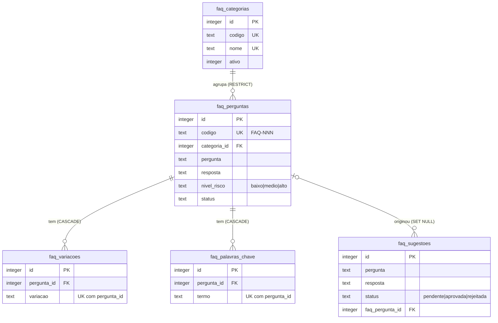
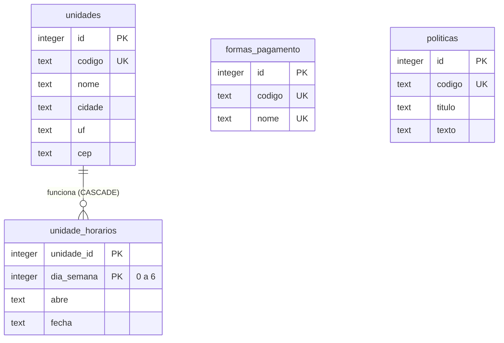
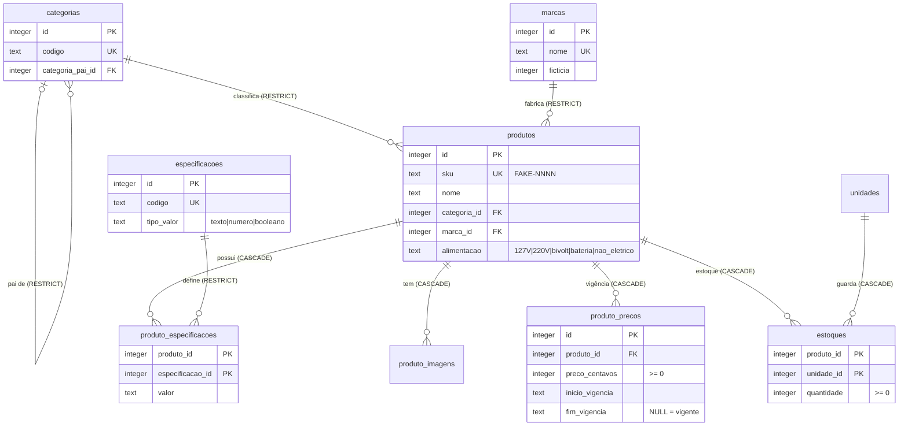
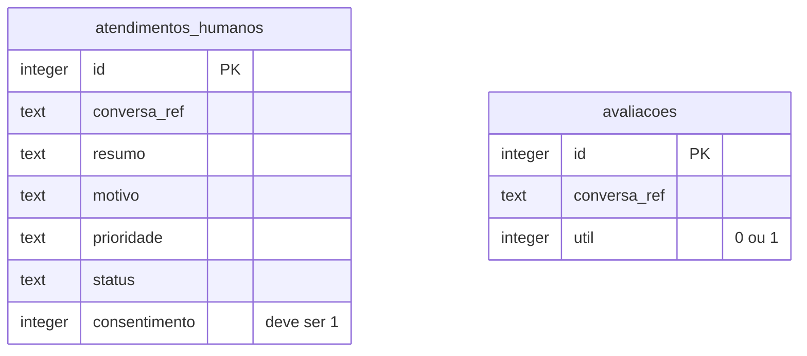

# DER — Diagrama entidade-relacionamento

> 19 tabelas em 4 domínios, uma migração por domínio. Detalhes de cada coluna em [DATA_DICTIONARY.md](DATA_DICTIONARY.md).

## 1. Base de conhecimento (0001_faq)

## 2. Loja (0002_loja)

## 3. Catálogo fictício (0003_catalogo)

## 4. Atendimento (0004_atendimento)

## Decisões de normalização

| Decisão | Forma normal / motivo |
|---------|-----------------------|
| Variações e palavras-chave em tabelas próprias (antes eram listas JSON numa coluna) | **1FN**: um valor por célula |
| Horários em `unidade_horarios` (uma linha por dia) | **1FN**; permite horários diferentes por dia |
| Especificações como entidade + tabela associativa com PK composta | **2FN**: o valor depende da chave inteira (produto, especificação) |
| Preço em `produto_precos` com vigência, não coluna em `produtos` | Histórico sem repetir dados do produto; **3FN** |
| Nome da marca e da categoria só nas suas tabelas | **3FN**: sem dependência transitiva em `produtos` |
| Estoque total e preço vigente **não** armazenados (calculados / view `vw_preco_atual`) | Dado derivado não é guardado (evita inconsistência) |
| Palavras de busca de `faq_sugestoes` derivadas da pergunta | Mesmo princípio: não armazenar o derivável |
| `alimentacao` como coluna de `produtos` | Atributo atômico, um valor por SKU (cada voltagem é um SKU diferente) |
| `atendimentos_humanos` sem nome, telefone ou CPF | Minimização de dados (LGPD); identificação só pelo `conversa_ref` |
| `conversa_ref` sem FK | Conversas ainda ficam em memória; a tabela `conversas` entra na fase de histórico (DB §4) |
